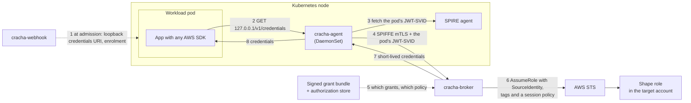

# Crachá

Crachá issues AWS credentials to Kubernetes workloads from their SPIFFE
identity: a few IAM roles per account, one per permission shape, with
per-workload session policies, attribution and revocation decided by a broker.
A node agent serves the credentials to each pod over loopback, inside the
pod's network namespace, so a workload trusts nothing, mounts nothing and
never holds its own SVID.

[docs/design.md](docs/design.md) is the design. Crachá is in its first release
candidates (0.1.0-rc), running end to end on a real cluster.

## How it works



1. **Admission.** For a pod whose ServiceAccount opts in, the webhook sets
   `AWS_CONTAINER_CREDENTIALS_FULL_URI` to a loopback address and arranges
   enrolment, by an init container or a chained CNI plugin.
2. **Enrolment.** The agent binds a listener on `127.0.0.1` inside the pod's
   own network namespace. Only that pod can reach it, so the listener a
   request arrives on is the pod's identity.
3. **A credential request.** The SDK asks the loopback endpoint. The agent
   fetches the pod's JWT-SVID from SPIRE on its behalf and presents it to the
   broker over SPIFFE mTLS. The pod never sees an SVID.
4. **The decision.** The broker verifies the SVID, looks the workload's
   grants up in the authorization store, composes a session policy from the
   signed grant bundle and checks it against the grant's envelope.
5. **AWS.** The broker assumes one shared shape role with the workload's
   SourceIdentity, session tags and that session policy, caches the session
   and returns it. CloudTrail attributes every call to the workload.

## Build

```bash
bazel test //...
```

See [AGENTS.md](AGENTS.md) for the build, layout and conventions.
