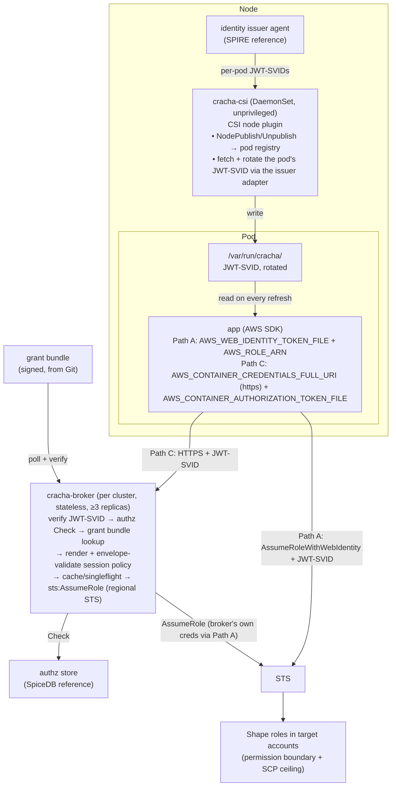
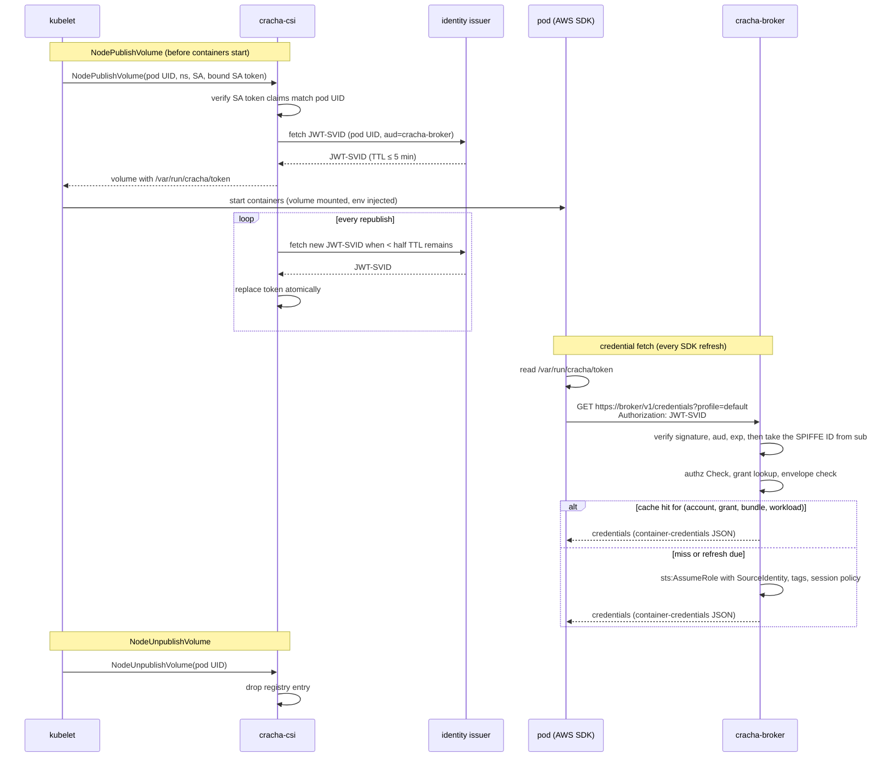

# Crachá: Workload AWS Credentials via SPIFFE Identity, a Credential Broker, a Pluggable Authorization Store and a Node Agent

Project: Crachá (`cracha`, https://cracha.dev) · Status: Draft · Owner: Bruno (platform) · Last updated: 2026-10-16

Naming: binaries and Kubernetes objects use the ASCII form `cracha-*`. The CSI driver, annotations and any API groups live under `cracha.dev` (e.g. `csi.cracha.dev`, `cracha.dev/enabled`).

## 1. Problem

IAM role quotas (1,000 roles per account by default, max 5,000) make "one IAM role per workload" unsustainable. Workloads still need different permissions. We need many logical permission sets backed by few IAM roles, with per-workload attribution and fast revocation, across any Kubernetes cluster, managed or self-hosted.

## 2. Goals / non-goals

Goals
- A few IAM roles per account, one per **permission shape** (e.g. `shape-s3-reader`, `shape-dynamo-rw`).
- Workload identity = **SPIFFE ID**, obtained through the standard SPIFFE Workload API from a pluggable issuer. SPIRE is the reference issuer, not a dependency of the design. Uniform across all clusters regardless of platform or cloud provider.
- Per-workload scope enforced via ABAC session tags and, where needed, **session policies** issued by a central broker.
- **Who may get what** lives in a **pluggable authorization store** behind a small, backend-neutral interface. SpiceDB is the reference backend, not a dependency of the design. **What a credential may look like** lives in a signed, Git-managed bundle.
- No application/SDK code changes. No AWS credentials on disk. The only on-disk secrets are JWT-SVIDs with a TTL of at most 5 minutes, each bound to a single audience.
- Attestation is the identity issuer's job. Crachá never re-attests a workload; it verifies what the issuer signed.
- CloudTrail attributes every call on a shared role to the real workload (`SourceIdentity`).
- Targeted revocation of live sessions for a single workload.

Non-goals
- Human access.
- Coupling the broker or node agent to one authorization engine or one identity issuer. Backend-specific types never leave their adapter package.
- Long-lived credentials.
- Replacing ABAC-only access (Path A) for the majority of workloads.

## 3. Architecture overview

Two credential paths share one identity system:

| Path | Use when | Mechanism |
|---|---|---|
| **A (default)** | Same actions, different resources | SDK reads a JWT-SVID (`aud=sts.amazonaws.com`) from a file and calls `sts:AssumeRoleWithWebIdentity` on a shape role itself; ABAC via session tags in the JWT |
| **C (broker)** | Permissions must be centrally narrowed and enforced | SDK reads a JWT-SVID (`aud=cracha-broker`) from a file and calls the broker over HTTPS using the container-credentials protocol → broker verifies the JWT → authz check → `sts:AssumeRole` with session policy + tags |

In both paths the pod's only secret is a short-lived JWT-SVID, written and rotated by cracha-csi, and the AWS SDK uses it through a provider it already has. Nothing in the cluster sits between the SDK and its credential source except, in Path C, the broker.

(Path B, IAM Roles Anywhere with X.509-SVIDs, is reserved for non-AWS-hosted workloads and is out of scope for the first implementation.)



## 4. Identity

The design depends on the **SPIFFE standard**, not on a particular issuer. Any issuer that meets the contract in 4.1 can be used; SPIRE is the reference implementation (4.2).

- **SPIFFE ID scheme:** `spiffe://<trust-domain>/ns/<namespace>/sa/<serviceaccount>`. The scheme is enforced by the issuer's registration policy, whatever the issuer.
- The cluster is **not** part of the identity. The same workload running in several clusters of a trust domain has one SPIFFE ID, so active-active deployments share grants by default. Cluster is context: in Path C the broker knows which cluster it serves and attaches it; in Path A it is available only when the issuer can add claims. Per-cluster scoping is expressed as an assignment condition (6.4), never as a separate identity.
- The issuer is a Tier-0 service: signing keys in KMS/HSM, per-region deployment or a nested hierarchy under a shared root.
- Crachá is trust-domain-agnostic. Trust domain topology (one domain with a nested hierarchy, or several federated domains) is the issuer operator's choice. It touches Crachá in two places only: Path A needs one IAM OIDC provider per trust domain, and a workload's identity is scoped to its trust domain, so per-region domains give the same workload a different identity per region.
- The service mesh (Istio, multi-primary) should eventually consume the same issuer via Envoy SDS, so mesh identity == AWS identity. Not required for v1.

### 4.1 Identity issuer contract

What Crachá needs from the issuer, and the standard mechanism for each:

| Need | Used by | Standard mechanism | Adapter responsibility |
|---|---|---|---|
| Own X.509-SVID and trust bundle (incl. federated bundles) | broker (JWT verification, service-to-service mTLS) | SPIFFE Workload API (`go-spiffe/v2`) | none, standard |
| JWT-SVID for its own identity | broker's own creds (Path A) | SPIFFE Workload API | none, standard |
| OIDC discovery (JWKS) for the trust domain | IAM OIDC provider (Path A) | SPIFFE OIDC federation, public HTTPS endpoint | issuer-specific deployment |
| ABAC claims in JWT-SVIDs (`https://aws.amazon.com/tags`) | Path A | no standard | issuer hook where available; otherwise ABAC tags are derived by IAM from `sub` path segments (`StringLike` conditions) |
| **Per-pod JWT-SVID obtained by cracha-csi on the pod's behalf** | cracha-csi (both paths) | SPIFFE Broker API (experimental; standardised under the SPIFFE project, not SPIRE-specific) | issuer adapter: fetch a JWT-SVID for a pod identified by a Kubernetes object reference (namespace, name, UID) for a given audience; the issuer resolves and attests the pod itself and refuses unknown or mismatched references |
| Node and workload attestation | all | issuer-specific | platform-specific attestor per cluster type (e.g. instance identity for cloud nodes, projected SA tokens for self-hosted clusters) |

Rules:
- The broker touches only the standard Workload API. Workloads touch nothing but a file. Both are issuer-agnostic by construction.
- The per-pod fetch is the one piece outside the Workload API. The SPIFFE Broker API covers it, but it is experimental, so it sits behind an adapter and cracha-csi has no issuer-specific code.
- Any issuer must guarantee: JWT-SVIDs are issued only for pods the issuer itself attested on that node, fetches for an unknown pod UID are refused, and the trust bundle is refreshed before key rotation.
- SPIRE is the reference issuer. Any SPIFFE-conformant issuer works if it can mint JWT-SVIDs with a chosen audience and offers a per-pod fetch to a node component. Without that hook, a sidecar using the standard Workload API can write the file instead, at the cost of one container per pod.

### 4.2 Reference issuer: SPIRE

- SPIRE server per region (or nested SPIRE under a shared upstream root). Keys via KMS/HSM UpstreamAuthority.
- Node attestation: `aws_iid` for EC2-backed nodes, `k8s_psat` for self-hosted clusters.
- Workload attestation: k8s workload attestor. Entries managed by SPIRE Controller Manager `ClusterSPIFFEID`.
- OIDC discovery: SPIRE OIDC Discovery Provider.
- ABAC claims: a **CredentialComposer** plugin adds `principal_tags` (ns, sa, cluster; plus service/team once the authz store is live).
- Per-pod JWT-SVID fetch: `FetchJWTSVID` on the **SPIFFE Broker API** served by the SPIRE agent (≥ 1.15.2, `experimental { broker { … } }`). The request carries a `KubernetesObjectReference` with namespace, name and UID. The agent's k8s workload attestor resolves and attests the pod itself, so every selector it can produce works in entries, and sending the UID makes it reject a recycled pod name. Not the Delegated Identity API: that needs hand-built selectors and `hostPID`.
  - cracha-csi is the configured broker: its own workload SVID is the mTLS client certificate the endpoint authorises against the broker `idTemplate`; `allowed_reference_types` = `KubernetesObjectReference` over the Unix socket only; `pod_reference_scope: agent_node`.
  - Access policy `enforced`: the agent runs a SubjectAccessReview with verb `impersonate-via-spire` on the pod, username = cracha-csi's SPIFFE ID, so RBAC bounds which pods it may fetch for. `permissive` only for bring-up.
  - Behaviour the adapter must handle: every call needs the `broker.spiffe.io: true` metadata; `NotFound` while the pod is not yet in kubelet's view is benign and retried with backoff; `Unavailable` during agent restarts and before cracha-csi's own SVID lands is retried quietly; JWT fetch is unary, so rotation is cracha-csi's job.

### 4.3 Identity encodings

Several systems restrict characters, so one deterministic encoding, owned by a single shared library, is used everywhere:

| Target | Constraint | Encoding |
|---|---|---|
| STS `SourceIdentity`, `RoleSessionName` | `[\w+=,.@-]`, 2–64 chars | `w.<td-short>.<ns>.<sa>`; if >64 chars → `w.h.<sha256 base32 prefix>` |
| Authz subject ID (SpiceDB object ID charset, the strictest backend considered) | `[a-zA-Z0-9/_\|\-=+]`, ≤1024 | `<td-short>/<ns>/<sa>` (no `.`/`:`; escape rule defined by the library) |
| Session tags | standard tag charset | raw `ns`, `sa`, `cluster` values |

The mapping (encoded → full SPIFFE ID) is logged at every issuance to keep audit reversible.

## 5. Path A: JWT-SVID direct federation (default)

- The issuer's OIDC discovery endpoint at a public HTTPS URL; registered as an IAM OIDC provider per trust domain.
- JWT-SVID with `aud=sts.amazonaws.com`, TTL ≤ 5 min, written to the pod by cracha-csi (7). The SDK's web-identity provider reads it from `AWS_WEB_IDENTITY_TOKEN_FILE` on every refresh and calls `AssumeRoleWithWebIdentity` on the role in `AWS_ROLE_ARN`. `AWS_ROLE_SESSION_NAME` is set to the STS encoding of the workload (4.3).
- ABAC tags come from the `https://aws.amazon.com/tags` claim (`principal_tags`: ns, sa, cluster; plus service/team once the authz store is live) when the issuer can add it (SPIRE: CredentialComposer). Without that hook, policies fall back to `StringLike` conditions on the `sub` path segments, which covers ns/sa but not cluster, service or team.
- One role per shape; trust policy `StringLike` on `<provider>:sub` (scoped pattern) and allows `sts:TagSession`.
- Policies scope resources with `${aws:PrincipalTag/...}` and `aws:ResourceTag/...`.
- The broker's own credentials use Path A.

## 6. Path C: credential broker

### 6.1 Responsibilities split

- **Grant bundle (Git, signed):** shapes, base roles, policy templates, allowed ARN envelopes, profiles. Answers *what*.
- **Authorization store (pluggable, SpiceDB reference):** assignments of grants to services/workloads, service membership, ownership, temporary access. Answers *who*.

### 6.2 Grant definition (bundle)

```yaml
kind: Grant
metadata:
  name: payments-ledger-rw
spec:
  account: "111122223333"
  baseRole: arn:aws:iam::111122223333:role/broker/shape-dynamo-rw
  profile: default                 # named profiles for workloads needing >1 shape
  sessionPolicy:
    template: dynamo-table-rw
    params: { tables: [ledger, ledger-outbox] }   # or resolved via the authz store (Level 3)
  managedPolicyArns: []            # escape hatch for large policies (max 10)
  sessionTags: { team: payments }
  duration: 3600                   # optional; default 1h, capped at 1h by role chaining
  envelope:                        # runtime ARN allowlist for rendered policies
    - arn:aws:dynamodb:*:111122223333:table/payments-*
```

CI (`grant-compiler`) pipeline:
1. Render templates.
2. Access Analyzer `ValidatePolicy`.
3. `CheckNoNewAccess` against the shape's envelope policy.
4. Size budget lint (2,048-char inline session policy + packed tag budget).
5. Uniqueness: at most one grant per (profile, account) per assignee.
6. Compile → sign (KMS or cosign) → publish to S3.

Broker polls the bundle, verifies signature, swaps atomically, and **keeps the last good bundle on failure (never fails open).**

### 6.3 Authorization store contract

The broker depends only on this contract. Each backend is an adapter chosen by configuration, and all adapters must give the same answers to the same questions.

| Question | Operation | Answer | Required |
|---|---|---|---|
| May this workload assume this grant? | Check(subject, grant, consistency) | allow/deny, the matching grant (ambiguity is a deny, see 6.5), ABAC tags such as service and team, a consistency token, a decision trace | yes |
| Which grants (profiles) may this workload assume? | ListGrants(subject, consistency) | grant list + consistency token | yes |
| Which resources of a kind may this workload use? | LookupResources(subject, kind, permission) | resource list, for Level 3 template filling | optional |
| What changed since this token? | Watch(since) | stream of assignment changes, for cache invalidation | optional; without it the cache degrades to TTL-only invalidation |

Rules:
- Subject = the workload's authz encoding (4.3) plus the cluster the broker serves. The subject never carries anything the workload can set itself.
- Consistency tokens are opaque outside the adapter. SpiceDB's zedToken is one implementation; a static backend may use a file hash. Callers may ask for minimize-latency or at-least-as-fresh(token).
- Any failure to answer is a deny. Backends never fail open.
- Time-bounded and cluster-bounded assignments are part of the model, not of one backend's caveat feature. A backend without native conditions evaluates them in its adapter.
- Backends: `static` (signed assignment file, for bootstrap, air-gapped or tiny installs) and `spicedb` (reference). OpenFGA or a Cedar-based store would be further adapters, not design changes.

### 6.4 Reference backend: SpiceDB

The model below is the reference. Another backend must express the same concepts (team, service, workload, grant, account, time-bounded and cluster-bounded assignment) and give equivalent answers to the questions in 6.3.

```zed
definition team {}

definition service {
  relation owner: team
  relation member: workload
}

definition workload {}            // id = idenc authz encoding

definition aws_account {}

caveat within_window(expires_at timestamp, now timestamp) {
  now < expires_at
}

caveat in_clusters(allowed list<string>, cluster string) {
  cluster in allowed
}

definition grant {
  relation account: aws_account
  relation assignee_service: service | service with in_clusters
  relation assignee_workload: workload with within_window
  permission assume = assignee_service->member + assignee_workload
}

definition dynamodb_table {       // Level 3 only
  relation account: aws_account
  relation writer: service
  relation reader: service
  permission write = writer->member
  permission read  = write + reader->member
}
```

Integration levels:
- **L1 (v1):** `Store.Check(subject, grant)` gates issuance (SpiceDB: `CheckPermission(grant#assume, workload)`).
- **L2 (v1):** service/team returned in `Decision.Tags` become session tags for ABAC.
- **L3 (later, exceptions only):** `Store.LookupResources` fills template resource lists; every ARN is validated against the grant envelope at runtime; violations reject the request.

Relationship writers (write access to the authz store is security-critical, whatever the backend). Where a writer reads its source of truth from is out of scope; what Crachá requires is that the writer is trusted and that no relationship is derived from anything the workload controls:

| Relationship | Source of truth | Writer |
|---|---|---|
| `service#owner`, `grant#assignee_service` | Git (CODEOWNERS) | `authz-reconciler` |
| `service#member@workload` | Service catalog / Git. **Never** workload-controlled annotations | `authz-reconciler` |
| Temporary / break-glass | Approval flow | `access-approver`, with caveat/expiry |

Deployment (SpiceDB): one instance per region on its own Postgres. The reconciler writes to every region through the backend adapter (regions stay independent).

### 6.5 Broker API

```
GET /v1/credentials?profile=default[&account=111122223333]
    Authorization: <JWT-SVID, aud=cracha-broker>      (SPIFFE ID from `sub`)

200 { "AccessKeyId", "SecretAccessKey", "Token", "Expiration" }   container-credentials format
    Cracha-Grant: payments-ledger-rw
    Cracha-Bundle-Version: ...
    Cracha-Consistency-Token: ...
403 { "reason": "no_grant" | "ambiguous" | "subject_suspended" | "envelope_violation" }

GET /v1/profiles              (same authorization) → profiles the caller can assume (`Store.ListGrants`)
```

The request is exactly what the SDK's container-credentials provider sends, so the broker is a drop-in credential source for any SDK. Query parameters are fixed per workload by the webhook (7.4).

Authentication:
- The broker validates the JWT-SVID with go-spiffe against the trust bundle (and federated bundles) from its own Workload API: signature, `aud=cracha-broker`, `exp`, and that `sub` matches the SPIFFE ID scheme (4).
- TLS is terminated by the broker with a certificate the pods' images already trust (public CA or the organisation's PKI). It must not rely on `AWS_CA_BUNDLE` pointing at the SPIFFE bundle, because that variable replaces the SDK's whole trust store and would break every other AWS call.
- The broker is reachable from every pod, so it is hardened as a public-facing service: per-SPIFFE-ID rate limits, strict JWT parsing, a network policy limiting ingress to its port, exclusion from mesh interception, and no trust in proxy-asserted identity headers.

### 6.6 STS mechanics

- Broker's role (`cracha-broker`, per environment) → `AssumeRole` on shape roles. This is role chaining, so the session max is 1 hour. Session duration is configurable per grant and defaults to 1 hour; targeted revocation (6.8) covers the window.
- Each call sets:
  - `SourceIdentity` = `RoleSessionName` = idenc STS encoding (per workload, not per pod)
  - `Policy` / `PolicyArns` = rendered session policy
  - session tags: `spiffe-ns`, `spiffe-sa`, `cluster`, `grant`, `team`, `service` (non-transitive)
- Shape role trust policy:

```json
{
  "Effect": "Allow",
  "Principal": { "AWS": "arn:aws:iam::PLATFORM:role/cracha-broker-prod" },
  "Action": ["sts:AssumeRole", "sts:SetSourceIdentity", "sts:TagSession"],
  "Condition": {
    "StringLike": { "sts:SourceIdentity": "w.*" },
    "ForAllValues:StringEquals": {
      "aws:TagKeys": ["spiffe-ns", "spiffe-sa", "cluster", "grant", "team", "service"]
    }
  }
}
```

- Shape role ceiling: permission boundary with explicit denies on `iam:*`, `sts:AssumeRole*`, `organizations:*`, key administration; backed by SCPs.
- Separate `cracha-broker` roles per environment/account tier. A dev broker can't assume prod shapes.

### 6.7 Caching

- Broker cache key: `(account, grant, bundleVersion, encoded workload)`. In-memory only, singleflight on miss, refresh-ahead at ~70% TTL, never return creds with <20 min left.
- **Re-check the authz store on every issuance, including cache hits** (cheap at refresh frequency).
- `Store.Watch` invalidates affected cache entries on assignment changes. Backends without Watch degrade to TTL-only invalidation, and the broker exposes which mode is active.
- Consistency: minimize latency by default; at-least-as-fresh when a caller (approver/revocation tool) supplies a consistency token.
- Authz store unavailable: fail closed for new keys; serve cache hits only if the last successful check for that key is <10 min old.

### 6.8 Revocation

1. Stop issuance: remove the relationship (or suspend the grant in the bundle) and flush the cache via Watch.
2. Kill live sessions: `revoke-tool` attaches an inline deny to the shape role, scoped to one workload, and removes it after 1h:

```json
{ "Effect": "Deny", "Action": "*", "Resource": "*",
  "Condition": {
    "StringEquals": { "aws:SourceIdentity": "w.prod.payments.ledger" },
    "DateLessThan": { "aws:TokenIssueTime": "2026-10-16T14:00:00Z" } } }
```

Optionally triggered automatically when Watch observes an assignment deletion.

## 7. Delivery: cracha-csi (CSI node plugin)

cracha-csi has one job: put the pod's JWT-SVID where the AWS SDK reads it before the app starts, and keep it fresh. It exists because the two parties cannot talk to each other: the SDK only reads a token from a file, and the issuer's agent only hands tokens over the Workload API to the process that asks.

Its role:
- **Bridge.** It asks the issuer for the pod's JWT-SVID on the pod's behalf and writes the answer where the SDK looks.
- **Ordering.** As a CSI plugin it runs inside NodePublishVolume, which kubelet completes before creating containers. A valid token therefore exists at the first SDK use, with no waiting or retry logic in the application.
- **Rotation.** Kubelet republishes the volume periodically; cracha-csi replaces the token once less than half its TTL remains. The SDK re-reads the file at each refresh, so rotation is invisible to the app.
- **Context check, not attestation.** It verifies the kubelet-supplied bound ServiceAccount token against the pod UID it was given. Workload attestation is the issuer's: the fetch names the pod by namespace, name and UID, and the issuer resolves, attests and answers only for pods its own agent sees on that node.

What it is not:
- Not on the request path. The SDK talks to STS or the broker directly; a cracha-csi restart is invisible to running pods until their next rotation.
- Not a credential holder. It caches nothing and never sees AWS credentials.
- Not privileged. No host networking, no host PID namespace, no capabilities. Its host access is the kubelet plugin socket and the issuer agent's socket.

Its blast radius equals the node's: a compromised cracha-csi can obtain JWT-SVIDs for pods on that node, which a compromised node could already do through the issuer agent. It therefore shares the node's blast radius without widening it.

### 7.1 CSIDriver

```yaml
apiVersion: storage.k8s.io/v1
kind: CSIDriver
metadata:
  name: csi.cracha.dev
spec:
  attachRequired: false
  podInfoOnMount: true
  volumeLifecycleModes: [Ephemeral]
  requiresRepublish: true
  tokenRequests:
    - audience: cracha-csi
      expirationSeconds: 600
```

### 7.2 Volume contents (read-only to the container, plugin-owned)

```
/var/run/cracha/
└── token         JWT-SVID for the workload's path:
                  aud=sts.amazonaws.com (Path A) or aud=cracha-broker (Path C)
```

One file, one audience. A workload is on one path; the webhook decides which (7.4).

### 7.3 NodePublishVolume and rotation

1. Read pod UID, namespace, SA from the volume context (kubelet-supplied).
2. Verify the kubelet-provided bound SA token. Its pod-binding claims must match the volume-context pod UID.
3. Register the pod. Fetch its JWT-SVID for the path's audience through the issuer adapter (SPIRE: Broker API `FetchJWTSVID` with a Kubernetes object reference of namespace, name and UID). The issuer refuses pods it cannot resolve and attest on this node. Containers have not started at this point, so only pod-level selectors (namespace, service account, labels) are available; the ID scheme (4) keys on exactly those.
4. Write the token atomically (write temp + rename).

Kubelet doesn't start containers until publish succeeds, so a valid token is present before app start.

`requiresRepublish`: on every republish, re-validate the pod and replace the token once less than half its TTL remains. With a 5-minute TTL the file is never older than 2.5 minutes, and the SDK re-reads it at each credential refresh.

`NodeUnpublishVolume`: drop the registry entry. No subscriptions or caches exist to clean up.

### 7.4 Webhook (`cracha-webhook`)

For ServiceAccounts annotated `cracha.dev/enabled: "true"`, inject the CSI inline volume, `AWS_REGION` (from the node's topology region, or the cluster default), and the path's environment:

| Path | Selected by | Injected |
|---|---|---|
| A (default) | `cracha.dev/role-arn: <shape role>` on the SA | `AWS_WEB_IDENTITY_TOKEN_FILE=/var/run/cracha/token`, `AWS_ROLE_ARN=<shape role>`, `AWS_ROLE_SESSION_NAME=<STS encoding>` |
| C | `cracha.dev/path: broker` on the SA, optional `cracha.dev/profile`, `cracha.dev/account` | `AWS_CONTAINER_CREDENTIALS_FULL_URI=https://<broker>/v1/credentials?profile=<p>[&account=<a>]`, `AWS_CONTAINER_AUTHORIZATION_TOKEN_FILE=/var/run/cracha/token` |

It strips or rejects `AWS_ACCESS_KEY_ID`, `AWS_SECRET_ACCESS_KEY`, `AWS_CONFIG_FILE`, `AWS_SHARED_CREDENTIALS_FILE`, and any `AWS_WEB_IDENTITY_*`, `AWS_ROLE_*`, `AWS_CONTAINER_CREDENTIALS_*` or `AWS_CONTAINER_AUTHORIZATION_*` the pod set itself. IMDS is blocked for pods (hop limit 1 / CNI policy).

### 7.5 Sequence (Path C; Path A is the same with STS in place of the broker)



### 7.6 Workload requirements

- Path A: an SDK whose default chain supports `AWS_WEB_IDENTITY_TOKEN_FILE`. All first-party SDKs have since 2019.
- Path C: an SDK that supports an HTTPS `AWS_CONTAINER_CREDENTIALS_FULL_URI` together with `AWS_CONTAINER_AUTHORIZATION_TOKEN_FILE`. Added across first-party SDKs for EKS Pod Identity (releases from late 2023). The image must trust the broker's certificate (6.5).
- Nothing else: no exec, no shell, no config file, no sidecar.
- One credential source per process. A workload that needs more than one shape at once is an open question (10).

### 7.7 cracha-csi hardening

- Distroless, read-only rootfs, dedicated namespace. No host networking, no host PID namespace, no capabilities. The only host access is the kubelet plugin socket and the issuer agent's socket.
- Issuer agent: the per-pod fetch is restricted to cracha-csi's identity (SPIRE: cracha-csi's SPIFFE ID is the only configured broker, access policy `enforced`, reference scope `agent_node`). The Broker socket is mounted read-only. Registration entry restricted to the cracha-csi SA/namespace.
- Alert on per-pod JWT fetches for pod UIDs absent from the node's kubelet view.

## 8. Failure modes

| Failure | Behavior |
|---|---|
| Broker down | Path A unaffected. Path C pods keep their SDK-cached session until it expires (≤1h); new Path C pods start but fail their first credential fetch until the broker returns. |
| STS throttle/outage | Broker serves cache, retries with jitter, alerts on cache age. |
| Authz store down | Fail closed for new keys; bounded-staleness cache hits (<10 min since last check). |
| Identity issuer agent down | Token rotation stops; pods can refresh credentials only while their current token is valid (≤5 min), then run on their cached session until it expires. New pods block at publish. |
| cracha-csi restart | Registry rebuilt from kubelet pods + existing CSI mounts; token files persist, rotation resumes. No request-path impact. |
| Bad/unsigned bundle | Keep last good bundle, alert. Never fail open. |

## 9. Threat model (summary)

| Compromise | Impact | Mitigation |
|---|---|---|
| App container | Its own grants | Read-only volume; the only on-disk secret is a JWT-SVID with TTL ≤ 5 min bound to one audience, which yields nothing beyond the pod's own grants |
| Node | Pods on that node | Per-node parenting of workload entries, node attestation, short SVID TTL |
| cracha-csi | JWT-SVIDs of pods on that node (≈ node) | Unprivileged, hardening §7.7, RBAC-bounded fetch, fetch alerts |
| Broker | Grants in its environment, capped by shape ceilings | Dedicated nodes, per-env roles, alert on shape-role assumption without `SourceIdentity` / by other principals |
| Any pod abusing the broker (bearer replay, flooding) | Denial of service; replay limited to the victim pod's grants within token TTL | Strict JWT validation, per-identity rate limits, network policy, short token TTL |
| Grant repo | Misuse within shape envelopes | CODEOWNERS, `CheckNoNewAccess`, signed bundles |
| Authz store writes | Misassignment within shapes | Restricted writers, change-feed audit log, envelope check |
| Identity issuer (e.g. SPIRE server) | Mint any identity | Tier-0 controls, KMS/HSM keys |

## 10. Open questions

- Q1: Approval flow for temporary access: build vs reuse existing tooling.
- Q2: Workloads needing more than one shape in one process. The SDK takes one credential source per process; options are named profiles via a small `credential_process` helper, or splitting the workload.
- Q3: CSI plugin on the Broker API vs. a sidecar on the standard Workload API as the token writer. The sidecar avoids the experimental API at the cost of a container per pod.
- Q4: Confirm that the Broker API attests a pod at NodePublishVolume time, before any container has started, with pod-level selectors. Aether only uses it after CNI ADD with running containers.

## 11. Invariants

These hold regardless of backend, issuer or platform. Any implementation must be able to demonstrate each one.

- Never fail open: an unavailable authz store, issuer or bundle results in denial, or in serving already-issued credentials within bounded staleness, never in broader access.
- Every rendered session policy is checked against the grant's envelope before STS is called.
- `SourceIdentity` is set on every assumed session and is reversible to a SPIFFE ID through the decision log.
- Nothing writes AWS credentials to disk. The only on-disk secrets are JWT-SVIDs with a TTL of at most 5 minutes, each bound to a single audience.
- Crachá never attests a workload itself. Every credential decision starts from a JWT-SVID the issuer signed.
- The cache never returns credentials with less than 20 minutes remaining.
- All identity encodings come from the single shared encoding library. Nothing hand-formats a SourceIdentity or an authz subject ID.
- Backend-specific and issuer-specific types never leave their adapter.
- Diagrams in this document are Mermaid.
