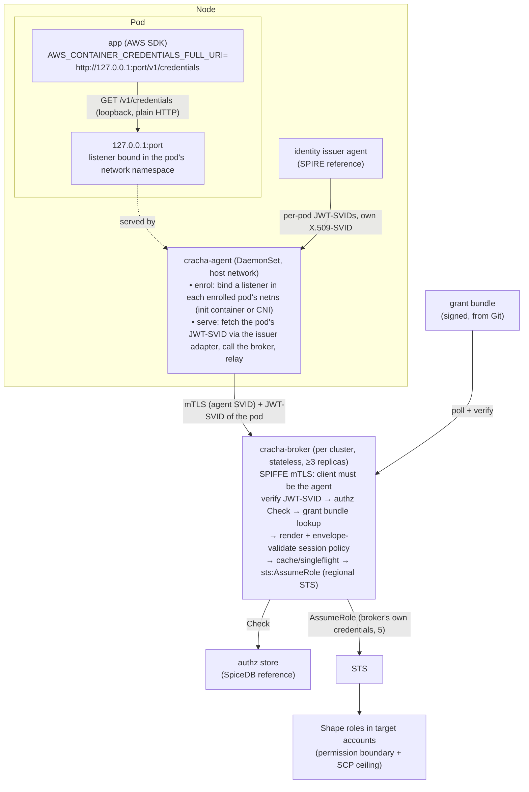

# Crachá: Workload AWS Credentials via SPIFFE Identity, a Credential Broker, a Pluggable Authorization Store and a Node Agent

Project: Crachá (`cracha`, https://cracha.dev) · Status: Draft · Owner: Bruno (platform) · Last updated: 2026-10-17

Naming: binaries and Kubernetes objects use the ASCII form `cracha-*`. Labels, annotations and any API groups live under `cracha.dev` (e.g. `cracha.dev/enabled`, `cracha.dev/credentials`).

## 1. Problem

IAM role quotas (1,000 roles per account by default, max 5,000) make "one IAM role per workload" unsustainable. Workloads still need different permissions. We need many logical permission sets backed by few IAM roles, with per-workload attribution and fast revocation, across any Kubernetes cluster, managed or self-hosted.

## 2. Goals / non-goals

Goals
- A few IAM roles per account, one per **permission shape** (e.g. `shape-s3-reader`, `shape-dynamo-rw`).
- Workload identity = **SPIFFE ID**, obtained through the standard SPIFFE Workload API from a pluggable issuer. SPIRE is the reference issuer, not a dependency of the design. Uniform across all clusters regardless of platform or cloud provider.
- Every credential is issued by a central broker, which sets per-workload ABAC session tags and, where needed, **session policies**. The issuer's keys never leave the cluster; AWS only ever sees the broker's role.
- **Who may get what** lives in a **pluggable authorization store** behind a small, backend-neutral interface. SpiceDB is the reference backend, not a dependency of the design. **What a credential may look like** lives in a signed, Git-managed bundle.
- No application/SDK code changes. No AWS credentials on disk, and nothing in the pod to trust, mount or protect: a workload reaches its credentials over loopback and never holds an SVID of its own.
- Attestation is the identity issuer's job. Crachá never re-attests a workload; it verifies what the issuer signed.
- CloudTrail attributes every call on a shared role to the real workload (`SourceIdentity`).
- Targeted revocation of live sessions for a single workload.

Non-goals
- Human access.
- Coupling the broker or node agent to one authorization engine or one identity issuer. Backend-specific types never leave their adapter package.
- Long-lived credentials.
- Direct federation of workload tokens with AWS (IRSA-style `AssumeRoleWithWebIdentity`, or IAM Roles Anywhere with X.509-SVIDs). Both publish the issuer's keys to AWS and bypass the authorization store.

## 3. Architecture overview

One credential path for every workload:

1. cracha-agent, one per node, binds a loopback listener (`127.0.0.1:<port>`) inside each enrolled pod's network namespace before the pod's app containers start, and serves the AWS container-credentials protocol on it over plain HTTP.
2. The AWS SDK's container-credentials provider, which every first-party SDK has, calls that loopback endpoint. A listener bound inside a pod's network namespace is reachable from that pod alone, so the agent knows which pod every request comes from by the listener it arrived on.
3. The agent fetches that pod's JWT-SVID (`aud=cracha-broker`) from the identity issuer on the pod's behalf, holds it in memory, and calls the broker with it over SPIFFE mTLS.
4. The broker verifies the JWT-SVID against the trust bundle, checks the authorization store, renders and validates the session policy, and calls `sts:AssumeRole` on a shape role with `SourceIdentity`, session tags and the session policy.
5. The agent relays the answer to the SDK, which caches the session and refreshes it through the same call.

The pod holds no secret at all: no token file, no certificate to trust, no volume. The application code is unchanged. Between the SDK and the broker there is one hop, the agent on the same node, which is what makes a loopback endpoint possible.



## 4. Identity

The design depends on the **SPIFFE standard**, not on a particular issuer. Any issuer that meets the contract in 4.1 can be used; SPIRE is the reference implementation (4.2).

- **SPIFFE ID scheme:** `spiffe://<trust-domain>/ns/<namespace>/sa/<serviceaccount>`. The scheme is enforced by the issuer's registration policy, whatever the issuer.
- The cluster is **not** part of the identity. The same workload running in several clusters of a trust domain has one SPIFFE ID, so active-active deployments share grants by default. Cluster is context: the broker knows which cluster it serves and attaches it. Per-cluster scoping is expressed as an assignment condition (6.4), never as a separate identity.
- The issuer is a Tier-0 service: signing keys in KMS/HSM, per-region deployment or a nested hierarchy under a shared root.
- Crachá is trust-domain-agnostic. Trust domain topology (one domain with a nested hierarchy, or several federated domains) is the issuer operator's choice. It touches Crachá in one place only: a workload's identity is scoped to its trust domain, so per-region domains give the same workload a different identity per region. AWS never learns about trust domains, because only the broker talks to STS.
- The service mesh (Istio, multi-primary) should eventually consume the same issuer via Envoy SDS, so mesh identity == AWS identity. Not required for v1.

### 4.1 Identity issuer contract

What Crachá needs from the issuer, and the standard mechanism for each:

| Need | Used by | Standard mechanism | Adapter responsibility |
|---|---|---|---|
| Own X.509-SVID and trust bundle (incl. federated bundles) | broker (JWT verification, mTLS with the agent), cracha-agent (mTLS with the broker), webhook (serving certificate) | SPIFFE Workload API (`go-spiffe/v2`) | none, standard |
| **Per-pod JWT-SVID obtained by cracha-agent on the pod's behalf** | cracha-agent | SPIFFE Broker API (experimental; standardised under the SPIFFE project, not SPIRE-specific) | issuer adapter: fetch a JWT-SVID for a pod identified by a Kubernetes object reference (namespace, name, UID) for a given audience; the issuer resolves and attests the pod itself and refuses unknown or mismatched references |
| Node and workload attestation | all | issuer-specific | platform-specific attestor per cluster type (e.g. instance identity for cloud nodes, projected SA tokens for self-hosted clusters) |

Rules:
- The broker touches only the standard Workload API. Workloads touch nothing but loopback. Both are issuer-agnostic by construction.
- The per-pod fetch is the one piece outside the Workload API. The SPIFFE Broker API covers it, but it is experimental, so it sits behind an adapter and cracha-agent has no issuer-specific code.
- Any issuer must guarantee: JWT-SVIDs are issued only for pods the issuer itself attested on that node, fetches for an unknown pod UID are refused, and the trust bundle is refreshed before key rotation.
- SPIRE is the reference issuer. Any SPIFFE-conformant issuer works if it can mint JWT-SVIDs with a chosen audience and offers a per-pod fetch to a node component. Without that hook, a sidecar using the standard Workload API can serve the loopback endpoint from inside the pod instead, at the cost of one container per pod.

### 4.2 Reference issuer: SPIRE

Crachá asks three things of SPIRE: (1) the agent's SPIFFE ID authorised as a broker of the SPIFFE Broker API, for the per-pod fetch; (2) a registration entry for the webhook pods whose X.509-SVID carries the webhook's DNS name; (3) default entries for everything else, so every workload and the three components have an identity. Nothing about token lifetimes: the 5-minute JWT-SVID TTL of earlier revisions was dropped (below).

- SPIRE server per region (or nested SPIRE under a shared upstream root). Keys via KMS/HSM UpstreamAuthority.
- Node attestation: `aws_iid` for EC2-backed nodes, `k8s_psat` for self-hosted clusters.
- Workload attestation: k8s workload attestor. Entries managed by SPIRE Controller Manager `ClusterSPIFFEID`. The default entries give every workload, and the broker, the agent and the webhook, `spiffe://<td>/ns/<namespace>/sa/<serviceaccount>`; the broker authorises the agent's ID (6.5) and the agent the broker's (7.3), so neither needs a DNS SAN.
- Per-pod JWT-SVID fetch: `FetchJWTSVID` on the **SPIFFE Broker API** served by the SPIRE agent (≥ 1.15.2, `experimental { broker { … } }`). The request carries a `KubernetesObjectReference` with namespace, name and UID. The agent's k8s workload attestor resolves and attests the pod itself, so every selector it can produce works in entries, and sending the UID makes it reject a recycled pod name. Not the Delegated Identity API: that needs hand-built selectors and `hostPID`.
  - cracha-agent is the configured broker: its own workload SVID is the mTLS client certificate the endpoint authorises against the broker `idTemplate`; `allowed_reference_types` = `KubernetesObjectReference` over the Unix socket only; `pod_reference_scope: agent_node`.
  - Access policy `enforced`: the agent runs a SubjectAccessReview with verb `impersonate-via-spire` on the pod, username = cracha-agent's SPIFFE ID, so RBAC bounds which pods it may fetch for. `permissive` only for bring-up.
  - Verified on SPIRE 1.15 (2026-10-17): `FetchJWTSVID` succeeds for a pod that kubelet has accepted but whose sandbox, IP and containers do not exist yet, so the fetch may happen as early as enrolment (7.2), and a reference whose UID does not match the pod is refused with `NotFound`. The pod's entry must have reached the agent first: with the controller manager this is the entry-cache reload plus the agent sync interval (seconds), so the first fetch for a new pod is retried.
  - The JWT-SVID TTL is the issuer's: SPIRE's default of 1 hour (`jwt_svid_ttl`, controller manager `ClusterSPIFFEID.spec.jwtSVIDTTL`) is acceptable. The cap of 5 minutes in earlier revisions bounded the life of a token on a pod's disk; there is no such token now. The token's only audience is the broker, it is held in the agent's memory and presented to the broker, nowhere else, and the agent requests it on demand (7.3). Its TTL therefore bounds nothing a workload can reach, and the invariant of section 11 is that the workload never holds it.
  - Behaviour the adapter must handle: every call needs the `broker.spiffe.io: true` metadata; `NotFound` while the pod is not yet in kubelet's view is benign and retried with backoff; `Unavailable` during agent restarts and before cracha-agent's own SVID lands is retried quietly; JWT fetch is unary, so fetching again when a token expires is cracha-agent's job.
- The webhook's serving certificate (7.5): a `ClusterSPIFFEID` for the webhook's service account with `dnsNameTemplates` giving its X.509-SVID the DNS SAN `cracha-webhook.<namespace>.svc`, the name the apiserver verifies. The webhook publishes the trust bundle it is issued under as its webhook configuration's `caBundle`, so nothing but SPIRE signs anything in Crachá.

### 4.3 Identity encodings

Several systems restrict characters, so one deterministic encoding, owned by a single shared library, is used everywhere:

| Target | Constraint | Encoding |
|---|---|---|
| STS `SourceIdentity`, `RoleSessionName` | `[\w+=,.@-]`, 2–64 chars | `w.<td-short>.<ns>.<sa>`; if >64 chars → `w.h.<sha256 base32 prefix>` |
| Authz subject ID (SpiceDB object ID charset, the strictest backend considered) | `[a-zA-Z0-9/_\|\-=+]`, ≤1024 | `<td-short>/<ns>/<sa>` (no `.`/`:`; escape rule defined by the library) |
| Session tags | standard tag charset | raw `ns`, `sa`, `cluster` values |

The mapping (encoded → full SPIFFE ID) is logged at every issuance to keep audit reversible.

## 5. Broker credentials

The broker is the only principal that calls STS, so it is the only thing that needs AWS credentials of its own. It gets them from the platform, not from the identity issuer:

- Preferred: the platform's native workload identity for the broker's pods (EKS Pod Identity, or an instance profile on the broker's dedicated nodes), bound to the `cracha-broker-<env>` role.
- Clusters without a platform identity: an IAM OIDC provider for the issuer's trust domain, used by the broker alone with its own JWT-SVID (`aud=sts.amazonaws.com`) through the SDK's web-identity provider, with a trust policy pinned to the broker's SPIFFE ID. This is the one case where the issuer's JWKS must be published to AWS, and it covers a single identity.

Shape-role trust policies name only the broker role (6.6), so workload identities are never visible to IAM.

## 6. Credential broker

### 6.1 Responsibilities split

- **Grant bundle (Git, signed):** shapes (base roles and their ARN envelopes) and grants (policy templates with parameters). Answers *what*.
- **Authorization store (pluggable, SpiceDB reference):** assignments of grants to services/workloads, service membership, ownership, temporary access. Answers *who*.

### 6.2 Grant definition (bundle)

```yaml
kind: Grant
metadata:
  name: payments-ledger-rw
spec:
  account: "111122223333"
  baseRole: arn:aws:iam::111122223333:role/broker/shape-dynamo-rw
  sessionPolicy:
    template: dynamo-table-rw
    params: { tables: [ledger, ledger-outbox] }   # or resolved via the authz store (Level 3)
  managedPolicyArns: []            # escape hatch for large policies (max 10)
  sessionTags: { team: payments }
  duration: 3600                   # optional; default 1h, capped at 1h by role chaining
  envelope:                        # runtime ARN allowlist for rendered policies
    - arn:aws:dynamodb:*:111122223333:table/payments-*
```

Who holds a grant is recorded beside it, in the same tree, as a `kind: Service` (a team's workloads and the grants they share) and `kind: Assignment` (one workload's own grants, or its suspension) documents. They are not part of the bundle: the authorization store answers who holds what (6.1), and the `authz-reconciler` of 6.4 writes it there from these documents, which also let the composition lint (step 5) check what each workload will hold.

```yaml
kind: Service
metadata:
  name: payments-api
spec:
  team: payments                   # the owning team; the "team" session tag
  members:                         # authz subject encodings (4.3); a workload is in at most one service
    - prod/payments/ledger
    - prod/payments/api
  grants:                          # every member holds these
    - name: payments-ledger-rw
    - name: payments-outbox-r
      expiresAt: "2026-12-31T00:00:00Z"   # optional bounds, as on an Assignment
      clusters: [prod-us-east-1]
---
kind: Assignment
metadata:
  name: payments-ledger-temp
spec:
  subject: prod/payments/ledger
  grants: [payments-outbox-r]
  expiresAt: "2026-12-31T00:00:00Z"
  clusters: [prod-us-east-1]
  suspended: false                 # true: the subject holds nothing until cleared
```

A workload has exactly one shape, and its session policy is composed by the broker at issuance time from every grant currently assigned to it in the authorization store. Permissions therefore change by assignment, with no redeploy and no per-workload configuration. All grants assigned to one workload must share its shape; a mix of shapes is ambiguous and denied. There are no profiles: one workload, one shape, one credential source.

CI (`grant-compiler`) pipeline:
1. Render templates.
2. Access Analyzer `ValidatePolicy`.
3. `CheckNoNewAccess` against the shape's envelope policy.
4. Size budget lint (2,048-char inline session policy + packed tag budget).
5. Composition lint, for assignments known in Git: the union of an assignee's grants, from its own Assignments and from the Service it is a member of, stays within one shape, the size budget and the envelope. The broker re-checks all three at issuance, since assignments can also come from the approval flow.
6. Compile → sign (KMS or cosign) → publish to S3.

Broker polls the bundle, verifies signature, swaps atomically, and **keeps the last good bundle on failure (never fails open).**

### 6.3 Authorization store contract

The broker depends only on this contract. Each backend is an adapter chosen by configuration, and all adapters must give the same answers to the same questions.

| Question | Operation | Answer | Required |
|---|---|---|---|
| Which grants does this workload hold? | ListGrants(subject, consistency) | grant list, ABAC tags such as service and team, a consistency token, a decision trace | yes |
| Does this workload hold this grant? | Check(subject, grant, consistency) | allow/deny + consistency token; used to re-validate cached sessions grant by grant | yes |
| Which resources of a kind may this workload use? | LookupResources(subject, kind, permission) | resource list, for Level 3 template filling | optional |
| What changed since this token? | Watch(since) | stream of assignment changes, for cache invalidation | optional; without it the cache degrades to TTL-only invalidation |

Rules:
- Subject = the workload's authz encoding (4.3) plus the cluster the broker serves. The subject never carries anything the workload can set itself.
- Consistency tokens are opaque outside the adapter. SpiceDB's zedToken is one implementation; a static backend may use a file hash. Callers may ask for minimize-latency or at-least-as-fresh(token).
- Any failure to answer is a deny. Backends never fail open.
- Time-bounded and cluster-bounded assignments are part of the model, not of one backend's caveat feature. A backend without native conditions evaluates them in its adapter.
- Backends: `static` (signed assignment file, for bootstrap, air-gapped or tiny installs) and `spicedb` (reference). OpenFGA or a Cedar-based store would be further adapters, not design changes. The broker's `--authz-backend` chooses one: `static` is `broker/internal/authz/static`, `spicedb` is `broker/internal/authz/spicedb`, the adapter over 6.4.

### 6.4 Reference backend: SpiceDB

The model below is the reference. Another backend must express the same concepts (team, service, workload, grant, account, time-bounded and cluster-bounded assignment, suspension) and give equivalent answers to the questions in 6.3. The schema lives in `common/spicedb/schema.zed`, with the names in it exported as constants, so the broker's adapter and the reconciler share one spelling of every type, relation, permission, caveat and context key.

```zed
definition team {}

definition service {
  relation owner: team
  relation member: workload
}

definition workload {
  relation suspended: team
  permission is_suspended = suspended
}

definition aws_account {}

caveat within_window(expires_at timestamp, now timestamp) {
  now < expires_at
}

caveat in_clusters(allowed list<string>, cluster string) {
  cluster in allowed
}

caveat bounded(expires_at timestamp, now timestamp, allowed list<string>, cluster string) {
  now < expires_at && cluster in allowed
}

definition grant {
  relation account: aws_account
  relation assignee_service: service | service with within_window | service with in_clusters | service with bounded
  relation assignee_workload: workload | workload with within_window | workload with in_clusters | workload with bounded
  permission assume = assignee_service->member + assignee_workload
}

definition dynamodb_table {
  relation account: aws_account
  relation writer: service
  relation reader: service
  permission write = writer->member
  permission read  = write + reader->member
}
```

Why it is shaped so:
- `workload#suspended` and `is_suspended` let SpiceDB express the suspension the contract reports as `ErrSubjectSuspended` (6.3): a workload with the permission holds nothing, whatever `grant#assume` would say. The relation's subject is the team of the workload's service, or `team:none` when it has no service, so the relationship has a subject and a suspension stays attributable.
- A SpiceDB relationship carries at most one caveat, and a Git assignment may carry both bounds, so `bounded` takes both; `within_window` and `in_clusters` stay for a relationship bound in only one way. Every assignee relation admits all four forms. The broker sends `now` (RFC 3339) and `cluster` as the caveat context of every query; the relationship carries `expires_at` and/or `allowed`.
- Object IDs: `workload:<authz encoding of 4.3>` (the encoding's charset is a subset of SpiceDB's), `grant:<name>`, `service:<name>`, `team:<name>`, `aws_account:<id>`. Names in Git are DNS labels for this reason.

Integration levels:
- **L1 (v1):** `Store.Check(subject, grant)` gates issuance (SpiceDB: `CheckPermission(grant#assume, workload)`).
- **L2 (v1):** service/team returned in `Decision.Tags` become session tags for ABAC.
- **L3 (later, exceptions only):** `Store.LookupResources` fills template resource lists; every ARN is validated against the grant envelope at runtime; violations reject the request.

Relationship writers (write access to the authz store is security-critical, whatever the backend). What Crachá requires is that the writer is trusted and that no relationship is derived from anything the workload controls:

| Relationship | Source of truth | Writer |
|---|---|---|
| `grant#account`, `service#owner`, `service#member`, `grant#assignee_service`, `grant#assignee_workload`, `workload#suspended` | Git: the grant source tree of 6.2 (CODEOWNERS). **Never** workload-controlled annotations | `authz-reconciler` (`cracha-reconciler apply`) |
| Temporary / break-glass | Approval flow | `access-approver`, with caveat/expiry |

The reconciler's mapping, from the documents of 6.2 to relationships. A grant bounded in time alone carries `within_window{expires_at}`, in clusters alone `in_clusters{allowed}`, in both `bounded{expires_at, allowed}`, in neither no caveat:

| Source | Relationship | Caveat |
|---|---|---|
| Grant `g` with `spec.account` | `grant:g#account@aws_account:<account>` | none |
| Service `s` with `spec.team` | `service:s#owner@team:<team>` | none |
| Service `s`, each `spec.members` | `service:s#member@workload:<member>` | none |
| Service `s`, each `spec.grants` `g` | `grant:g#assignee_service@service:s` | by the grant's bounds |
| Assignment of `subject`, each `spec.grants` `g` | `grant:g#assignee_workload@workload:<subject>` | by the assignment's bounds |
| Assignment of `subject` with `suspended: true` | `workload:<subject>#suspended@team:<team of its service, or none>` | none |

Two Assignments that give one subject the same grant are one relationship, with the bounds that allow what either allows; when one caveat cannot express that union (one bound in time, the other in clusters, say) the reconciler refuses the tree. The reconciler owns every relationship whose resource is a `grant`, a `service` or a `workload`: it refuses a tree the loader or the lints of 6.2 reject, reads what SpiceDB holds, writes the difference (touches and deletes, in batches of at most 1,000) and reads back at least as fresh as its last write to confirm; a second run is a no-op, and a dry run writes nothing. It writes the schema with `cracha-reconciler schema`, which is idempotent.

Deployment (SpiceDB): one instance per region on its own Postgres. The reconciler writes to every region through the backend adapter (regions stay independent).

### 6.5 Broker API

```
GET /v1/credentials
    Authorization: <JWT-SVID, aud=cracha-broker>      (SPIFFE ID from `sub`)

200 { "AccessKeyId", "SecretAccessKey", "Token", "Expiration" }   container-credentials format
    Cracha-Shape: shape-dynamo-rw
    Cracha-Grants: payments-ledger-rw, payments-outbox-r
    Cracha-Bundle-Version: ...
    Cracha-Consistency-Token: ...
    Cracha-Cache: hit | miss | refresh      (6.7: served from the cache, issued by STS now, or served from the cache while a refresh-ahead started; absent with the cache off)
403 { "reason": "no_grant" | "ambiguous" | "subject_suspended" | "envelope_violation" | "policy_too_large" }

GET /v1/grants                (same authorization) → the caller's shape, grants and composed session policy, for inspection
```

The request is exactly what the SDK's container-credentials provider sends, relayed by the agent (7.3) with the pod's token added, and nothing workload-specific is in it: the identity in the token selects everything. The broker is therefore a drop-in credential source for any SDK. `ambiguous` means the caller's grants span more than one shape.

Authentication:
- Transport: the broker serves TLS with its own X.509-SVID from the Workload API (go-spiffe `tlsconfig.MTLSServerConfig`) and requires a client SVID. It authorises exactly one client identity, the agent's (`spiffe://<td>/ns/<namespace>/sa/cracha-agent`; `--agent-spiffe-id`, which the chart derives from the release and `broker.agentSpiffeID` overrides). A connection from any other SVID is refused before a request is read, and the client identity is logged with every request beside the token's subject. No DNS SAN and no CA bundle are involved anywhere: the agent verifies the broker by SPIFFE ID too (7.3). Nothing in a pod can reach the broker, because nothing in a pod holds an SVID.
- The broker validates the JWT-SVID with go-spiffe against the trust bundle (and federated bundles) from its own Workload API: signature, `aud=cracha-broker`, `exp`, and that `sub` matches the SPIFFE ID scheme (4). The agent presents the token but does not vouch for it; the broker's decision starts from what the issuer signed, as section 11 requires.
- The broker is reachable from every node, so it is hardened as a public-facing service: per-SPIFFE-ID rate limits on the token's subject, strict JWT parsing, a network policy limiting ingress to the agent's pods on its port, exclusion from mesh interception, and no trust in proxy-asserted identity headers.

### 6.6 STS mechanics

- Broker's role (`cracha-broker`, per environment) → `AssumeRole` on shape roles. This is role chaining, so the session max is 1 hour. Session duration is configurable per grant and defaults to 1 hour; targeted revocation (6.8) covers the window.
- Each call sets:
  - `SourceIdentity` = `RoleSessionName` = idenc STS encoding (per workload, not per pod)
  - `Policy` / `PolicyArns` = rendered session policy
  - session tags: `spiffe-ns`, `spiffe-sa`, `cluster`, `grant`, `team`, `service` (non-transitive)
- Shape role trust policy:

```json
{
  "Effect": "Allow",
  "Principal": { "AWS": "arn:aws:iam::PLATFORM:role/cracha-broker-prod" },
  "Action": ["sts:AssumeRole", "sts:SetSourceIdentity", "sts:TagSession"],
  "Condition": {
    "StringLike": { "sts:SourceIdentity": "w.*" },
    "ForAllValues:StringEquals": {
      "aws:TagKeys": ["spiffe-ns", "spiffe-sa", "cluster", "grant", "team", "service"]
    }
  }
}
```

- Shape role ceiling: permission boundary with explicit denies on `iam:*`, `sts:AssumeRole*`, `organizations:*`, key administration; backed by SCPs.
- Separate `cracha-broker` roles per environment/account tier. A dev broker can't assume prod shapes.

### 6.7 Caching

- Broker cache key: `(shape, sorted grant set, bundleVersion, encoded workload)`. A change in the grant set is a new key, so an added or removed assignment takes effect at the next fetch. In-memory only, singleflight on miss, refresh-ahead at ~70% of the usable lifetime (the TTL less the 20-minute floor: 28 minutes into a one-hour session), never return creds with <20 min left.
- **Re-check the authz store on every issuance, including cache hits** (cheap at refresh frequency).
- `Store.Watch` invalidates affected cache entries on assignment changes. Backends without Watch degrade to TTL-only invalidation, and the broker exposes which mode is active.
- Consistency: minimize latency by default; at-least-as-fresh when a caller (approver/revocation tool) supplies a consistency token.
- Authz store unavailable: fail closed for new keys; serve cache hits only if the last successful check for that key is <10 min old.

### 6.8 Revocation

1. Stop issuance: remove the relationship (or suspend the grant in the bundle) and flush the cache via Watch. The kind suite exercises this (`E2E_AUTHZ=spicedb e2e/run.sh`): the reconciler removes the assignment, the next fetch is refused within seconds and the broker's log shows the flush came from Watch.
2. Kill live sessions: `revoke-tool` attaches an inline deny to the shape role, scoped to one workload, and removes it after 1h:

```json
{ "Effect": "Deny", "Action": "*", "Resource": "*",
  "Condition": {
    "StringEquals": { "aws:SourceIdentity": "w.prod.payments.ledger" },
    "DateLessThan": { "aws:TokenIssueTime": "2026-10-16T14:00:00Z" } } }
```

Optionally triggered automatically when Watch observes an assignment deletion.

## 7. Delivery: cracha-agent (node agent)

cracha-agent has one job: answer the AWS SDK's credential requests from inside every enrolled pod, with an answer the broker issued for that pod's identity. It exists because the SDK and the broker cannot talk to each other on acceptable terms: the SDK's container-credentials provider accepts only a loopback or an HTTPS endpoint, HTTPS means a certificate every workload image trusts, and the issuer's agent hands a pod's token only to a node component that asks on the pod's behalf. A loopback listener inside the pod asks nothing of the image: no CA, no file, no volume.

Its role:
- **Loopback endpoint.** For every enrolled pod it binds `127.0.0.1:<agent.port>` inside that pod's network namespace and serves the container-credentials protocol on it (7.1).
- **Identity by socket.** A listener bound inside a pod's network namespace is reachable from that pod alone, so the listener a request arrived on names the pod. Nothing in the request is trusted for identity (7.1).
- **Bridge.** It asks the issuer for the pod's JWT-SVID on the pod's behalf, holds it in memory and presents it to the broker over SPIFFE mTLS (7.3). The workload never holds its SVID.
- **Ordering.** Enrolment (7.2) completes before the pod's app containers start, in both of its modes, so a listener exists at the first SDK use with no waiting or retry logic in the application.
- **Context check, not attestation.** In `init` mode it verifies the pod's bound ServiceAccount token with a TokenReview; in `cni` mode the container runtime names the pod. Workload attestation is the issuer's: the fetch names the pod by namespace, name and UID, and the issuer resolves, attests and answers only for pods its own agent sees on that node.

What it is not:
- Not a credential store. It holds a pod's JWT-SVID in memory for at most the token's lifetime, keeps no AWS credentials beyond the response in flight, and writes nothing to disk. Caching credentials is the broker's job (6.7).
- Not unprivileged. Entering a pod's network namespace is a privileged operation: the agent is a node component with host networking and the CRI socket (7.8), and its compromise is the node's, as the CSI plugin's was before it.
- Not a proxy for anything else. It relays `GET /v1/credentials` and `GET /v1/grants` (6.5) and nothing more; a pod cannot reach the broker at all.

Its blast radius equals the node's: a compromised cracha-agent can obtain JWT-SVIDs, and through them credentials, for pods on that node, which a compromised node could already do through the issuer agent. It shares the node's blast radius without widening it.

### 7.1 Listener: identity by socket

- One fixed port, `agent.port`, the same in every pod; the webhook writes it into `AWS_CONTAINER_CREDENTIALS_FULL_URI` (7.5). The listener is a TCP socket on `127.0.0.1:<agent.port>` created by a goroutine that has entered the pod's network namespace with `setns` on a locked OS thread, through the namespace path the runtime reports, and returns to the host namespace afterwards (the pattern is aether's `withPodNetns`, `cni/internal/plugin/netns.go`). A socket stays in the namespace it was created in after the thread leaves, so the agent serves it from the host namespace like any other listener.
- The agent keeps a registry of listener → pod (namespace, name, UID, network namespace path). Every request's pod is the registry entry of the listener it arrived on. Headers, source addresses and anything else the client sends carry no identity.
- Plain HTTP. The SDKs accept `http://` for a loopback host, and loopback traffic never leaves the pod's network namespace. The ECS and EKS link-local addresses (`169.254.170.2`, `169.254.170.23`) are not used: they need an address and a route in every pod's namespace, and the SDKs ask nothing of the kind of a loopback endpoint.
- Protocol: `GET /v1/credentials` returns the broker's answer unchanged (status, body and `Cracha-*` headers, 6.5); `GET /v1/grants` the same; anything else is 404. An answer the agent had to make itself carries `Cracha-Reason` (7.3).
- A pod with `hostNetwork: true` has no network namespace of its own, and a loopback listener there would be reachable by every process on the node. The webhook refuses such a pod (7.5) and the agent refuses to enrol one.
- The listener is closed when the pod goes (7.2); a request in flight fails.

### 7.2 Enrolment

Enrolment binds the listener in a new pod's network namespace before its app containers start. The mode is chosen per install, `agent.enrol: init | cni`, and the webhook (7.5) injects what the mode needs. In both modes the pod carries the label `cracha.dev/credentials: "true"`, which the agent checks through the API before it binds anything: the pod object exists by the time either mode runs, and a pod without the label is refused, whatever asked.

`init` (the default; needs nothing of the node but the agent):
- The webhook injects an init container `cracha-enrol`, first in the list, from the agent image (`cracha-agent enrol`), with a projected ServiceAccount token volume (audience `cracha-agent`, the shortest lifetime the API allows, bound to the pod) mounted into that container only, and the node's address from the downward API (`status.hostIP`). The pattern is aether's identity-gate init container (`controller/internal/podmutate/identitygate.go`): the container name is the idempotency key.
- The init container calls the agent over the node's address, `POST http://<hostIP>:<agent.enrolPort>/v1/enrol`, with the token as a bearer, and retries a refused or failed connection with backoff for `agent.enrolTimeout`; past it the container exits non-zero and kubelet restarts it (fail closed).
- The agent verifies the token with a TokenReview for audience `cracha-agent`, takes the pod's namespace, name and UID from the token's bound claims (the `authentication.kubernetes.io/pod-name` and `pod-uid` extras of the review), confirms the enrolment label, and resolves the pod's network namespace through the CRI socket (`ListPodSandbox` by the pod's UID, `PodSandboxStatus` for the namespace path; containerd and CRI-O both report it). A pod on another node names no sandbox here and is refused, which keeps enrolment node-local without trusting the caller's address. It binds the listener (7.1) and acknowledges.
- Before exiting, the init container confirms the listener accepts a connection from inside the pod (a connect, not a request), so a missed bind cannot start the app. App containers then start with the listener present.
- Nothing in the pod needs a capability, a hostPath or a volume beyond the projected token; it runs under the restricted Pod Security standard. The token crosses from the pod to the node in plain HTTP on the node-local path (9).

`cni` (nothing enters the pod spec but the env and the label):
- A chained CNI plugin, `cracha-cni` (built from the agent's tree, `agent/cni`), is installed on every node by an init container of the agent DaemonSet that copies the binary into the CNI bin directory and appends the plugin to the node's primary conflist (aether's `cni-install`, `cni/internal/install/config.go`); the netconf names the agent's Unix socket. The plugin is aether's pattern (`cni/internal/plugin/plugin.go`), its server side the agent's (`agent/internal/cni/server/server.go`).
- On `ADD` the plugin sends the agent the network namespace path (`CNI_NETNS`) and the pod reference (`K8S_POD_NAMESPACE`, `K8S_POD_NAME`, `K8S_POD_UID`) over the socket (`agent.cni.socket`, a host directory the agent owns) and returns the previous plugin's result. The agent looks the pod up: without the label it answers "not enrolled" and the plugin does nothing; with it, it binds the listener in the path it was given, which needs no CRI call. A failed bind fails the `ADD`, and kubelet tears the sandbox down and retries it (fail closed).
- On `DEL` the plugin tells the agent, which closes the listener.
- The plugin is on the sandbox path of every pod of the node, enrolled or not, because it cannot tell them apart without the agent: while the agent is down, every new pod on the node waits. `init` mode holds only enrolled pods. That is the trade: `cni` touches no pod spec, `init` touches no node configuration.

Both modes fail closed: a pod created while the agent is down waits for it rather than starting without credentials. In both modes the agent also watches the pods of its node (the same watch recovery uses, 7.4) and closes the listener of a pod that is gone, so `init` mode needs no deletion hook; `DEL` only makes it prompt. Enrolment never touches the issuer: the pod's entry reaches the node's issuer agent while the containers start, and the first request fetches the token (7.3).

### 7.3 Credential request

1. A request arrives on a listener; the registry (7.1) names the pod: namespace, name, UID. Only `GET /v1/credentials` and `GET /v1/grants` go further.
2. The agent needs the pod's JWT-SVID (`aud=cracha-broker`). It fetches it through the issuer adapter (SPIRE: Broker API `FetchJWTSVID` with a Kubernetes object reference of namespace, name and UID). The issuer refuses pods it cannot resolve and attest on this node. The first fetch for a new pod may precede its entry on the node's issuer agent: `NotFound` and `Unavailable` are retried with backoff within the request's budget (`agent.fetchDeadline`, a few seconds, under the SDKs' request timeouts), past which the agent answers 503 with `Cracha-Reason: issuer_not_ready` or `issuer_unavailable` and the SDK retries. The token is kept in memory, keyed by the pod, reused for the pod's later requests until it is within a minute of expiry, then fetched again, and dropped with the pod. It is never written anywhere and is held nowhere but the agent and, per request, the broker.
3. The agent calls `GET <agent.brokerUrl>/v1/credentials` (or `/v1/grants`) over SPIFFE mTLS: its client certificate is its own X.509-SVID from the Workload API, the broker is verified by SPIFFE ID (`agent.brokerSpiffeID`, by default `spiffe://<td>/ns/<namespace>/sa/cracha-broker` of the release's trust domain), so no DNS SAN and no CA bundle exist on either side; `Authorization` carries the pod's JWT-SVID. One connection pool serves every pod.
4. The broker's answer is relayed unchanged: status, body, `Cracha-*` headers. A broker that is unreachable or does not answer in time is 503 with `Cracha-Reason: broker_unavailable`. The agent never synthesises credentials and never caches a response: every SDK refresh is a broker call, and the broker's cache (6.7) decides whether STS is called.
5. Each request is logged with the pod, the token's SPIFFE ID, the broker's status, `Cracha-Cache` and the latency. Requests are bounded per pod so one pod cannot starve the others.

### 7.4 Recovery

On every start the agent lists the enrolled pods of its node (label `cracha.dev/credentials`, field selector `spec.nodeName`), resolves each running pod's network namespace through the CRI socket exactly as `init` enrolment does, and binds its listener again. A listener that cannot be re-bound (no sandbox, a namespace path that is gone, a refused bind) is logged and retried on the next pass; until then the pod's requests are refused and its SDK keeps its cached session and retries. Pods created while the agent was down are waiting at enrolment (7.2) and enrol as soon as it listens. The restart is hitless for a pod whose SDK retries a refused connection, which every SDK's container-credentials provider does. Nothing is persisted: the registry of 7.1 is rebuilt from the API and the runtime, the agent's restart does not restart pods, and it leaves nothing on disk.

### 7.5 Webhook (`cracha-webhook`)

A mutating admission webhook on Pod CREATE. For pods whose ServiceAccount is annotated `cracha.dev/enabled: "true"` (looked up through the API, remembered briefly), inject into every container and init container:
- `AWS_CONTAINER_CREDENTIALS_FULL_URI=http://127.0.0.1:<agent.port>/v1/credentials`
- `AWS_REGION` from the cluster default, unless the container sets its own. The pod is not scheduled at admission, so the node's topology region is not available; the Namespace annotation `cracha.dev/region` overrides the default for the namespace's pods. The webhook reads it from a watch on the Namespaces (it needs `get`, `list` and `watch` on them, cluster-wide), never from the API on the admission path: a namespace the watch has not seen yet, or an empty annotation, means the default, and an annotation that is not shaped like an AWS region refuses the pod as invalid rather than injecting it.

and onto the pod:
- the label `cracha.dev/credentials: "true"`, the enrolment mark the agent checks (7.2)
- in `init` mode only: the `cracha-enrol` init container, its projected token volume and the node's address (7.2)

No token file, no `AWS_CONTAINER_AUTHORIZATION_TOKEN_FILE`, no CA bundle, no volume for the app containers. A pod that already carries the label is left unchanged.

It rejects (by default) or strips (`--conflicting-env=strip`, recording what it removed in `cracha.dev/stripped-env`) `AWS_ACCESS_KEY_ID`, `AWS_SECRET_ACCESS_KEY`, `AWS_SESSION_TOKEN`, `AWS_CONFIG_FILE`, `AWS_SHARED_CREDENTIALS_FILE`, and any `AWS_WEB_IDENTITY_*`, `AWS_ROLE_*`, `AWS_CONTAINER_CREDENTIALS_*` or `AWS_CONTAINER_AUTHORIZATION_*` the pod set itself, whether literal or from `valueFrom`. It rejects a pod with `hostNetwork: true` (7.1), and a pod that already carries an init container or a volume named `cracha-enrol` it did not inject. A failure to look the ServiceAccount up denies the pod rather than admitting it unwired, and the webhook configuration's `failurePolicy` must be `Fail` for the same to hold when the webhook itself is unreachable. IMDS is blocked for pods (hop limit 1 / CNI policy).

TLS. The apiserver speaks HTTPS to the webhook and verifies it by its Service name. The webhook serves its X.509-SVID from the Workload API, whose entry carries the DNS SAN `cracha-webhook.<namespace>.svc` (4.2), and follows the Workload API's rotation. The chart renders the `MutatingWebhookConfiguration` without a `caBundle`; at start, and on every change of its trust bundle, the webhook patches the `caBundle` of its own configuration with the bundle's certificates (RBAC: `patch` on that one `MutatingWebhookConfiguration` by `resourceNames`, and nothing else on the kind). Until the first patch the apiserver cannot reach the webhook and, with `failurePolicy: Fail`, admits no pod of the namespaces the webhook covers; that window is the webhook's start. The configuration's `namespaceSelector` excludes the webhook's own namespace (a pod there must not depend on the webhook to start) and the identity issuer's namespaces (the webhook's certificate comes from the issuer's agent, which must therefore start without the webhook); `webhook.excludedNamespaces` lists both and anything else.

### 7.6 Sequence

```mermaid
sequenceDiagram
    participant K as kubelet / runtime
    participant W as cracha-webhook
    participant N as cracha-agent
    participant I as identity issuer
    participant P as pod (AWS SDK)
    participant B as cracha-broker

    Note over W,P: pod creation
    W->>W: admission: label, env, in init mode the cracha-enrol init container
    alt agent.enrol = init
        K->>P: start init container cracha-enrol (projected token, aud=cracha-agent)
        P->>N: POST http://hostIP:enrolPort/v1/enrol, bearer token
        N->>N: TokenReview → pod UID; label check; CRI PodSandboxStatus → netns path
        N->>N: bind 127.0.0.1:port inside the pod's netns
        N-->>P: 200
        P->>P: connect to 127.0.0.1:port succeeds, init container exits
    else agent.enrol = cni
        K->>N: CNI ADD via cracha-cni over the Unix socket: netns path, pod reference
        N->>N: label check; bind 127.0.0.1:port inside the netns path
        N-->>K: ok (an error fails the sandbox; kubelet retries)
    end
    K->>P: start app containers (listener present)

    Note over P,B: first credential request
    P->>N: GET http://127.0.0.1:port/v1/credentials
    N->>N: listener → pod (ns, name, UID)
    N->>I: FetchJWTSVID(pod reference, aud=cracha-broker), retried on NotFound
    I-->>N: JWT-SVID (kept in memory)
    N->>B: GET /v1/credentials over SPIFFE mTLS<br/>Authorization: JWT-SVID
    B->>B: client SVID is the agent's; verify signature, aud, exp, sub
    B->>B: authz ListGrants, compose session policy, envelope check
    alt cache hit for (shape, grant set, bundle, workload)
        B-->>N: credentials + Cracha-* headers
    else miss or refresh due
        B->>B: sts:AssumeRole with SourceIdentity, tags, session policy
        B-->>N: credentials + Cracha-* headers
    end
    N-->>P: credentials (container-credentials JSON)

    Note over P,B: rotation (every SDK refresh)
    P->>N: GET http://127.0.0.1:port/v1/credentials
    N->>N: reuse the pod's JWT-SVID, or fetch again near its expiry
    N->>B: GET /v1/credentials
    B-->>N: credentials (cache, 6.7)
    N-->>P: credentials

    Note over K,N: pod deletion
    alt agent.enrol = cni
        K->>N: CNI DEL
    else agent.enrol = init
        N->>N: pod gone from the node's pod watch
    end
    N->>N: close the listener, drop the pod's token
```

### 7.7 Workload requirements

- An AWS SDK with the container-credentials provider, which accepts a plain-HTTP `AWS_CONTAINER_CREDENTIALS_FULL_URI` on a loopback host. Every first-party SDK and the CLI have it: it is the ECS provider, older than the HTTPS and token-file extensions added for EKS Pod Identity.
- Nothing to trust, nothing to mount, nothing to read: no CA, no volume, no token file, no sidecar, no exec, no shell, no config file.
- One credential source per process. A workload that needs more than one shape at once is an open question (10).

### 7.8 cracha-agent hardening

- Distroless, read-only rootfs, dedicated namespace, service account `cracha-agent`. Host network: the enrolment endpoint of `init` mode listens on the node's address, and the listeners the agent binds live in pods' namespaces, not its own. Every capability dropped but `CAP_SYS_ADMIN`, which `setns` into a network namespace requires. It enters by the namespace path the runtime reports, so it needs no host PID namespace and not `CAP_SYS_PTRACE` (the `/proc/<pid>/ns/net` alternative), and neither is granted. `CAP_CHOWN` went with the token file.
- Host mounts: the CRI socket, read-only (`agent.criSocket`); the issuer's Workload API and Broker API sockets, read-only; in `cni` mode the directory of its own socket (`agent.cni.socket`) and, for the installer init container only, the CNI bin and conf directories (`agent.cni.binDir`, `agent.cni.confDir`). Nothing else: no kubelet directory, no pod volumes.
- RBAC: `pods` get, list and watch (the agent filters to its node; the API cannot), `tokenreviews` create for `init` mode. No Secrets, no writes.
- The enrolment endpoint accepts nothing without a bound token the TokenReview verifies for audience `cracha-agent`, answers only enrol and ack, and is rate-limited per source pod UID.
- Issuer agent: the per-pod fetch is restricted to cracha-agent's identity (SPIRE: cracha-agent's SPIFFE ID is the only configured broker, access policy `enforced`, reference scope `agent_node`). The Broker socket is mounted read-only. Registration entry restricted to the cracha-agent SA/namespace.
- Alert on per-pod JWT fetches for pod UIDs absent from the node's kubelet view.

## 8. Failure modes

| Failure | Behavior |
|---|---|
| Broker down | Running pods keep their SDK-cached session until it expires (≤1h); a refresh gets 503 `Cracha-Reason: broker_unavailable` from the agent and the SDK retries. New pods enrol and start, and fail their first credential fetch until the broker returns. |
| STS throttle/outage | Broker serves cache, retries with jitter, alerts on cache age. |
| Authz store down | Fail closed for new keys; bounded-staleness cache hits (<10 min since last check). |
| Identity issuer agent down | The Broker API is unavailable: the agent answers 503 `issuer_unavailable` once the pod's in-memory token has expired, and pods run on their SDK-cached session until it expires. New pods enrol (enrolment does not touch the issuer) and fail their first fetch until it returns. |
| cracha-agent down | New pods wait at enrolment: the init container retries, or the CNI `ADD` fails and kubelet retries (in `cni` mode every new pod of the node, 7.2). Running pods' requests are refused until it returns; the SDKs retry and keep their cached session. On return it re-binds every enrolled pod (7.4). |
| CRI socket unavailable | Recovery and `init` enrolment cannot resolve a network namespace: new `init`-mode pods wait, listeners not yet re-bound stay down. `cni` mode still enrols new pods, since the plugin hands the agent the namespace path. |
| Bad/unsigned bundle | Keep last good bundle, alert. Never fail open. |

## 9. Threat model (summary)

| Compromise | Impact | Mitigation |
|---|---|---|
| App container | Its own grants | Nothing in the pod: no token, no file, no volume. Credentials come only from loopback, which yields nothing beyond the pod's own grants, and the SVID never enters the pod. A process in the pod reads credentials from loopback exactly as it could read the token file before. |
| Node | Pods on that node | Per-node parenting of workload entries, node attestation, short SVID TTL |
| cracha-agent | JWT-SVIDs and credentials of pods on that node (≈ node) | A privileged node component (host network, CRI socket, namespace entry, TokenReview) whose compromise is node compromise, as the CSI plugin's was. Hardening §7.8, RBAC-bounded fetch, fetch alerts |
| Node-local path (`init` mode) | The enrolment token, and in both modes nothing else, crosses from the pod to the node in plain HTTP on the node's address; the credentials response crosses loopback inside the pod | The same trust boundary the on-disk token had: the node is trusted, and the token is bound to one pod, one audience and minutes of life |
| Anything reaching the broker (bearer replay, flooding) | Denial of service; replay limited to the victim pod's grants within token TTL | The broker accepts only the agent's SVID, so a stolen JWT-SVID is useless without an agent's identity; strict JWT validation, per-identity rate limits at the broker and per-pod bounds at the agent, network policy |
| Broker | Grants in its environment, capped by shape ceilings | Dedicated nodes, per-env roles, alert on shape-role assumption without `SourceIdentity` / by other principals |
| Grant repo | Misuse within shape envelopes | CODEOWNERS, `CheckNoNewAccess`, signed bundles |
| Authz store writes | Misassignment within shapes | Restricted writers, change-feed audit log, envelope check |
| Identity issuer (e.g. SPIRE server) | Mint any identity | Tier-0 controls, KMS/HSM keys |

## 10. Open questions

- Q1: Approval flow for temporary access. The model already has the primitive: a time-bounded assignment (`grant#assignee_workload` with the `within_window` condition) written by a trusted `access-approver` (6.4), which the broker picks up at the next fetch and which expires on its own. What is undecided is the human side:
  - Who may request, and who approves: the owning team from `service#owner` is the natural approver, with a second approver for production shapes.
  - Where the request and approval are recorded, so the decision log can point at an attributable approval, and how break-glass (pre-approved, short expiry, loud audit) differs from planned access.
  - Options: (a) a Git change carrying `expiresAt`, approved through CODEOWNERS and applied by the reconciler. Reuses existing review tooling, no new service, minutes of latency. (b) Integration with an existing access-request or just-in-time tool that calls the `access-approver` writer. Fastest for users, one more integration to secure. (c) A small purpose-built approver (CLI or chat bot). Most flexible, most to build and to harden, since it holds write access to the authorization store.
  - Constraints whichever is chosen: the writer is the only path to a temporary relationship, every relationship carries an expiry, and revocation (6.8) must be able to end it early.

## 11. Invariants

These hold regardless of backend, issuer or platform. Any implementation must be able to demonstrate each one.

- Never fail open: an unavailable authz store, issuer or bundle results in denial, or in serving already-issued credentials within bounded staleness, never in broader access.
- Every rendered session policy is checked against the grant's envelope before STS is called.
- `SourceIdentity` is set on every assumed session and is reversible to a SPIFFE ID through the decision log.
- Nothing writes AWS credentials or SVIDs to disk. The workload never holds an SVID: its JWT-SVID lives in the agent's memory and is presented to the broker, nowhere else.
- Credentials are served to a workload over loopback only, from a listener bound inside that pod's network namespace and nowhere else. The pod a request is answered for is the pod the listener was bound in.
- The broker accepts only the agent's SVID on its TLS layer. Nothing in a pod can reach it.
- Crachá never attests a workload itself. Every credential decision starts from a JWT-SVID the issuer signed.
- The cache never returns credentials with less than 20 minutes remaining.
- All identity encodings come from the single shared encoding library. Nothing hand-formats a SourceIdentity or an authz subject ID.
- Backend-specific and issuer-specific types never leave their adapter.
- Diagrams in this document are Mermaid.
