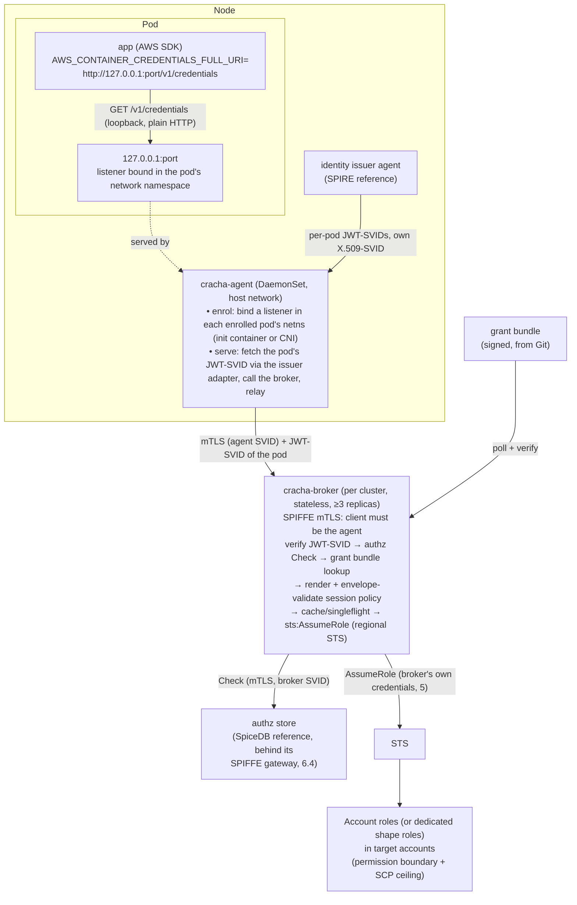
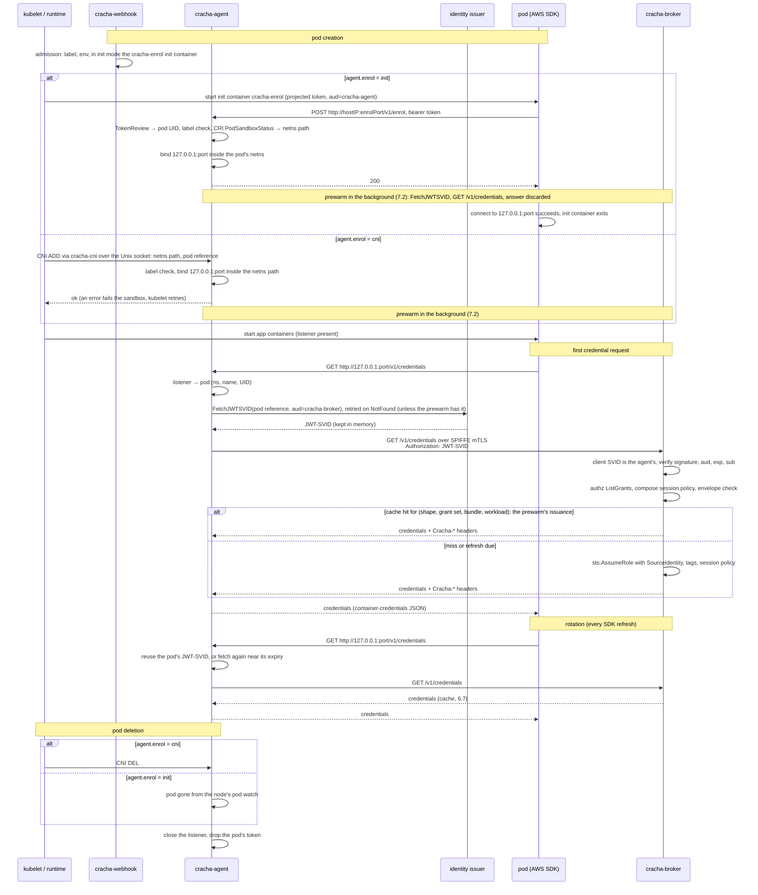

# Crachá: Workload AWS Credentials via SPIFFE Identity, a Credential Broker, a Pluggable Authorization Store and a Node Agent

Project: Crachá (`cracha`, https://cracha.dev) · Status: Draft · Owner: Bruno (platform) · Last updated: 2026-10-18

Naming: binaries and Kubernetes objects use the ASCII form `cracha-*`. Labels, annotations and any API groups live under `cracha.dev` (e.g. `cracha.dev/enabled`, `cracha.dev/credentials`).

## 1. Problem

IAM role quotas (1,000 roles per account by default, max 5,000) make "one IAM role per workload" unsustainable. Workloads still need different permissions. We need many logical permission sets backed by few IAM roles, with per-workload attribution and fast revocation, across any Kubernetes cluster, managed or self-hosted.

## 2. Goals / non-goals

Goals
- One IAM role per account by default, the **account role**, shared by every workload of the account; the session policy the broker composes scopes each workload, and IAM holds the role in with a permission boundary and SCPs (6.6). A dedicated role per **permission shape** (e.g. `shape-legacy-batch`) is the exception a grant asks for by name.
- Workload identity = **SPIFFE ID**, obtained through the standard SPIFFE Workload API from a pluggable issuer. SPIRE is the reference issuer, not a dependency of the design. Uniform across all clusters regardless of platform or cloud provider.
- Every credential is issued by a central broker, which sets per-workload ABAC session tags and, where needed, **session policies**. The issuer's keys never leave the cluster; AWS only ever sees the broker's role.
- **Who may get what** lives in a **pluggable authorization store** behind a small, backend-neutral interface. SpiceDB is the reference backend, not a dependency of the design. **What a credential may look like** lives in a signed, Git-managed bundle.
- No application/SDK code changes. No AWS credentials on disk, and nothing in the pod to trust, mount or protect: a workload reaches its credentials over loopback and never holds an SVID of its own.
- Attestation is the identity issuer's job. Crachá never re-attests a workload; it verifies what the issuer signed.
- CloudTrail attributes every call on a shared role to the real workload (`SourceIdentity`).
- Targeted revocation of live sessions for a single workload.

Non-goals
- Human access.
- Coupling the broker or node agent to one authorization engine or one identity issuer. Backend-specific types never leave their adapter package.
- Long-lived credentials.
- Direct federation of workload tokens with AWS (IRSA-style `AssumeRoleWithWebIdentity`, or IAM Roles Anywhere with X.509-SVIDs). Both publish the issuer's keys to AWS and bypass the authorization store.

## 3. Architecture overview

One credential path for every workload:

1. cracha-agent, one per node, binds a loopback listener (`127.0.0.1:<port>`) inside each enrolled pod's network namespace before the pod's app containers start, and serves the AWS container-credentials protocol on it over plain HTTP.
2. The AWS SDK's container-credentials provider, which every first-party SDK has, calls that loopback endpoint. A listener bound inside a pod's network namespace is reachable from that pod alone, so the agent knows which pod every request comes from by the listener it arrived on.
3. The agent fetches that pod's JWT-SVID (`aud=cracha-broker`) from the identity issuer on the pod's behalf, holds it in memory, and calls the broker with it over SPIFFE mTLS.
4. The broker verifies the JWT-SVID against the trust bundle, checks the authorization store, renders and validates the session policy, and calls `sts:AssumeRole` on the account role (or a grant's dedicated shape role) with `SourceIdentity`, session tags and the session policy.
5. The agent relays the answer to the SDK, which caches the session and refreshes it through the same call.

The pod holds no secret at all: no token file, no certificate to trust, no volume. The application code is unchanged. Between the SDK and the broker there is one hop, the agent on the same node, which is what makes a loopback endpoint possible.



## 4. Identity

The design depends on the **SPIFFE standard**, not on a particular issuer. Any issuer that meets the contract in 4.1 can be used; SPIRE is the reference implementation (4.2).

- **SPIFFE ID scheme:** `spiffe://<trust-domain>/ns/<namespace>/sa/<serviceaccount>`. The scheme is enforced by the issuer's registration policy, whatever the issuer.
- The cluster is **not** part of the identity. The same workload running in several clusters of a trust domain has one SPIFFE ID, so active-active deployments share grants by default. Cluster is context: the broker knows which cluster it serves and attaches it. Per-cluster scoping is expressed as an assignment condition (6.4), never as a separate identity.
- The issuer is a Tier-0 service: signing keys in KMS/HSM, per-region deployment or a nested hierarchy under a shared root.
- Crachá is trust-domain-agnostic. Trust domain topology (one domain with a nested hierarchy, or several federated domains) is the issuer operator's choice. It touches Crachá in one place only: a workload's identity is scoped to its trust domain, so per-region domains give the same workload a different identity per region. AWS never learns about trust domains, because only the broker talks to STS.
- The service mesh (Istio, multi-primary) should eventually consume the same issuer via Envoy SDS, so mesh identity == AWS identity. Not required for v1.

### 4.1 Identity issuer contract

What Crachá needs from the issuer, and the standard mechanism for each:

| Need | Used by | Standard mechanism | Adapter responsibility |
|---|---|---|---|
| Own X.509-SVID and trust bundle (incl. federated bundles) | broker (JWT verification, mTLS with the agent), cracha-agent (mTLS with the broker), webhook (serving certificate) | SPIFFE Workload API (`go-spiffe/v2`) | none, standard |
| **Per-pod JWT-SVID obtained by cracha-agent on the pod's behalf** | cracha-agent | SPIFFE Broker API (experimental; standardised under the SPIFFE project, not SPIRE-specific) | issuer adapter: fetch a JWT-SVID for a pod identified by a Kubernetes object reference (namespace, name, UID) for a given audience; the issuer resolves and attests the pod itself and refuses unknown or mismatched references |
| Node and workload attestation | all | issuer-specific | platform-specific attestor per cluster type (e.g. instance identity for cloud nodes, projected SA tokens for self-hosted clusters) |

Rules:
- The broker touches only the standard Workload API. Workloads touch nothing but loopback. Both are issuer-agnostic by construction.
- The per-pod fetch is the one piece outside the Workload API. The SPIFFE Broker API covers it, but it is experimental, so it sits behind an adapter and cracha-agent has no issuer-specific code.
- Any issuer must guarantee: JWT-SVIDs are issued only for pods the issuer itself attested on that node, fetches for an unknown pod UID are refused, and the trust bundle is refreshed before key rotation.
- SPIRE is the reference issuer. Any SPIFFE-conformant issuer works if it can mint JWT-SVIDs with a chosen audience and offers a per-pod fetch to a node component. Without that hook, a sidecar using the standard Workload API can serve the loopback endpoint from inside the pod instead, at the cost of one container per pod.

### 4.2 Reference issuer: SPIRE

Crachá asks three things of SPIRE: (1) the agent's SPIFFE ID authorised as a broker of the SPIFFE Broker API, for the per-pod fetch; (2) a registration entry for the webhook pods whose X.509-SVID carries the webhook's DNS name; (3) default entries for everything else, so every workload and the three components have an identity. Nothing about token lifetimes: the 5-minute JWT-SVID TTL of earlier revisions was dropped (below).

- SPIRE server per region (or nested SPIRE under a shared upstream root). Keys via KMS/HSM UpstreamAuthority.
- Node attestation: `aws_iid` for EC2-backed nodes, `k8s_psat` for self-hosted clusters.
- Workload attestation: k8s workload attestor. Entries managed by SPIRE Controller Manager `ClusterSPIFFEID`. The default entries give every workload, and the broker, the agent and the webhook, `spiffe://<td>/ns/<namespace>/sa/<serviceaccount>`; the broker authorises the agent's ID (6.5) and the agent the broker's (7.3), so neither needs a DNS SAN.
- Per-pod JWT-SVID fetch: `FetchJWTSVID` on the **SPIFFE Broker API** served by the SPIRE agent (≥ 1.15.2, `experimental { broker { … } }`). The request carries a `KubernetesObjectReference` with namespace, name and UID. The agent's k8s workload attestor resolves and attests the pod itself, so every selector it can produce works in entries, and sending the UID makes it reject a recycled pod name. Not the Delegated Identity API: that needs hand-built selectors and `hostPID`.
  - cracha-agent is the configured broker: its own workload SVID is the mTLS client certificate the endpoint authorises against the broker `idTemplate`; `allowed_reference_types` = `KubernetesObjectReference` over the Unix socket only; `pod_reference_scope: agent_node`.
  - Access policy `enforced`: the agent runs a SubjectAccessReview with verb `impersonate-via-spire` on the pod, username = cracha-agent's SPIFFE ID, so RBAC bounds which pods it may fetch for. `permissive` only for bring-up.
  - Verified on SPIRE 1.15 (2026-10-17): `FetchJWTSVID` succeeds for a pod that kubelet has accepted but whose sandbox, IP and containers do not exist yet, so the fetch may happen as early as enrolment (7.2), and a reference whose UID does not match the pod is refused with `NotFound`. The pod's entry must have reached the agent first: with the controller manager this is the entry-cache reload plus the agent sync interval (seconds), so the first fetch for a new pod is retried.
  - The JWT-SVID TTL is the issuer's: SPIRE's server default of 5 minutes (`default_jwt_svid_ttl`; one hour is the X.509 default) is acceptable, and so is a longer one set per entry (`jwt_svid_ttl`, controller manager `ClusterSPIFFEID.spec.jwtSVIDTTL`). The cap of 5 minutes in earlier revisions bounded the life of a token on a pod's disk; there is no such token now. The token's only audience is the broker, it is held in the agent's memory and presented to the broker, nowhere else, and the agent requests it on demand (7.3). Its TTL therefore bounds nothing a workload can reach, and the invariant of section 11 is that the workload never holds it.
  - Behaviour the adapter must handle: every call needs the `broker.spiffe.io: true` metadata; `NotFound` while the pod is not yet in kubelet's view is benign and retried with backoff; `Unavailable` during agent restarts and before cracha-agent's own SVID lands is retried quietly; JWT fetch is unary, so fetching again when a token expires is cracha-agent's job.
- The webhook's serving certificate (7.5): a `ClusterSPIFFEID` for the webhook's service account with `dnsNameTemplates` giving its X.509-SVID the DNS SAN `cracha-webhook.<namespace>.svc`, the name the apiserver verifies. The webhook publishes the trust bundle it is issued under as its webhook configuration's `caBundle`, so nothing but SPIRE signs anything in Crachá.

### 4.3 Identity encodings

Several systems restrict characters, so one deterministic encoding, owned by a single shared library, is used everywhere:

| Target | Constraint | Encoding |
|---|---|---|
| STS `SourceIdentity`, `RoleSessionName` | `[\w+=,.@-]`, 2–64 chars | `w.<td-short>.<ns>.<sa>`; if >64 chars → `w.h.<sha256 base32 prefix>` |
| Authz subject ID (SpiceDB object ID charset, the strictest backend considered) | `[a-zA-Z0-9/_\|\-=+]`, ≤1024 | `<td-short>/<ns>/<sa>` (no `.`/`:`; escape rule defined by the library) |
| Authz resource ID (Level 3: an S3 bucket's or a DynamoDB table's object ID, same charset) | as the subject ID | the resource name with the subject encoding's component escape (`data.curated` → `data_2ecurated`); reversible, and an ID not in canonical form is refused when read back |
| Session tags | standard tag charset | raw `ns`, `sa`, `cluster` values |

The mapping (encoded → full SPIFFE ID) is logged at every issuance to keep audit reversible.

## 5. Broker credentials

The broker is the only principal that calls STS, so it is the only thing that needs AWS credentials of its own. It gets them from the platform, not from the identity issuer:

- Preferred: the platform's native workload identity for the broker's pods (EKS Pod Identity, or an instance profile on the broker's dedicated nodes), bound to the `cracha-broker-<env>` role.
- Clusters without a platform identity: an IAM OIDC provider for the issuer's trust domain, used by the broker alone with its own JWT-SVID (`aud=sts.amazonaws.com`) through the SDK's web-identity provider, with a trust policy pinned to the broker's SPIFFE ID. This is the one case where the issuer's JWKS must be published to AWS, and it covers a single identity.

Account-role and shape-role trust policies name only the broker role (6.6), so workload identities are never visible to IAM.

## 6. Credential broker

### 6.1 Responsibilities split

- **Grant bundle (Git, signed):** accounts (the account role, its default envelope and its access table, which says what a permission on a resource kind means in IAM), dedicated shapes (base roles and their ARN envelopes) and grants (policy templates with parameters). Answers *what*.
- **Authorization store (pluggable, SpiceDB reference):** assignments of grants to services/workloads, service membership, ownership, temporary access, and which resources a workload may reach (Level 3). Answers *who*, and for a lookup grant *which resources*.

### 6.2 Grant definition (bundle)

```yaml
kind: Account
metadata:
  name: payments                   # free; it names the account's implicit grants
spec:
  id: "111122223333"
  role: arn:aws:iam::111122223333:role/cracha/apps   # the account role
  envelope:                        # default envelope of the account's grants
    - arn:aws:dynamodb:*:111122223333:table/payments-*
    - arn:aws:s3:::payments-*
  access:                          # the access table: implicit grants (below)
    - kind: s3_bucket
      permission: read
      template: s3-object-read
---
kind: Grant
metadata:
  name: payments-ledger-rw
spec:
  account: "111122223333"
  baseRole: arn:aws:iam::111122223333:role/broker/shape-dynamo-rw   # optional: the override
  sessionPolicy:
    template: dynamo-table-rw
    params: { tables: [ledger, ledger-outbox] }   # or a lookup (Level 3, below)
  managedPolicyArns: []            # escape hatch for large policies (max 10)
  sessionTags: { team: payments }
  duration: 3600                   # optional; default 1h, capped at 1h by role chaining
  envelope:                        # runtime ARN allowlist for rendered policies; optional with an Account
    - arn:aws:dynamodb:*:111122223333:table/payments-*
```

An **Account** document names one AWS account (`spec.id`, 12 digits; one document per account), its **account role** (`spec.role`, a role ARN in that account), optionally the default envelope of its grants (`spec.envelope`), and optionally its **access table** (`spec.access`). A Grant of an account with an Account document may leave out `baseRole`, and is then issued on the account role, and `envelope`, which is then the account's; a Grant without `baseRole` whose account has no Account document is refused by the lint. `baseRole` is the override: a grant that names one is issued on that dedicated shape role. The role a workload's credential is issued on, the account role or a dedicated one, is its **shape** below, and `Cracha-Shape` names it.

Who holds a grant is recorded beside it, in the same tree, as a `kind: Service` (a team's workloads and the grants they share) and `kind: Assignment` (one workload's own grants, or its suspension) documents, and which resources a lookup grant reaches as `kind: Access` documents (below). They are not part of the bundle: the authorization store answers who holds what (6.1). For the static backend the compiler publishes them, beside the bundle, as the assignments document (below). They also let the composition lint (step 5) check what each workload will hold. With the SpiceDB backend these documents do not reach the store: relationships live only in SpiceDB, written by the access service (6.4).

```yaml
kind: Service
metadata:
  name: payments-api
spec:
  team: payments                   # the owning team; the "team" session tag
  members:                         # authz subject encodings (4.3); a workload is in at most one service
    - prod/payments/ledger
    - prod/payments/api
  grants:                          # every member holds these
    - name: payments-ledger-rw
    - name: payments-outbox-r
      expiresAt: "2026-12-31T00:00:00Z"   # optional bounds, as on an Assignment
      clusters: [prod-us-east-1]
---
kind: Assignment
metadata:
  name: payments-ledger-temp
spec:
  subject: prod/payments/ledger
  grants: [payments-outbox-r]
  expiresAt: "2026-12-31T00:00:00Z"
  clusters: [prod-us-east-1]
  suspended: false                 # true: the subject holds nothing until cleared
```

A grant may leave one template parameter to the authorization store instead of naming its resources (Level 3 of 6.4): the parameter is a lookup, `{lookup: {kind: s3_bucket, permission: read}}`, and which buckets a workload may reach is a relationship, recorded in the tree as a `kind: Access` document. Grants then become generic per kind of access, and giving a workload one more bucket is an Access document, not a new grant.

```yaml
kind: Grant
metadata:
  name: bucket-read
spec:
  account: "111122223333"
  baseRole: arn:aws:iam::111122223333:role/broker/shape-s3-read
  sessionPolicy:
    template: s3-object-read
    params:
      bucket: { lookup: { kind: s3_bucket, permission: read } }
  envelope:                        # required: every bucket found must fall in it
    - arn:aws:s3:::payments-*
---
kind: Access
metadata:
  name: payments-exports
spec:
  service: payments-api            # every member; or subject: prod/payments/ledger
  resource: { kind: s3_bucket, name: payments-exports }
  relation: reader                 # reader | writer
  expiresAt: "2026-12-31T00:00:00Z"   # optional bounds, as on an Assignment
  clusters: [prod-us-east-1]
```

- Kinds: `s3_bucket` and `dynamodb_table` (names checked by the kind's rules: S3's for buckets). Permissions: `read`, held through `reader` or `writer`, and `write`, through `writer` alone. A grant has at most one lookup parameter (a grant per kind of resource), and a template default is never a lookup.
- Rendering: the broker asks the store which resources of the kind the workload holds the permission on (`LookupResources`, 6.3), sorts them and renders the template with them. A parameter the template declares as a `list` is the resources, rendered once; one declared as a `string` is rendered once per resource and the statements of the renderings are put together under one `Version`, so a template written for one bucket, as every template before lookups was, serves any number. A template rendered once per resource must not repeat a statement `Sid` (the lint refuses it).
- Compiled maximum: the compiler renders the template for probe resources of the kind's longest name (63 characters for a bucket) and records in the bundle the most that fit the 2,048-character budget (`maxResources`); the broker refuses more with `policy_too_large`, and measures the real policy as for any grant. A template that does not fit one is refused.
- At issuance every Resource of the rendered policy must match the grant's envelope, or the request is refused with `resource_outside_envelope`. A lookup grant for which the store finds no resource is left out of the composition, so the workload keeps its other grants; when that leaves no grant, the refusal is `no_resources`. The decision log names the resources each lookup grant was rendered with, and the trace the relations that gave them.
- Lints: the kind and permission are known, the parameter is declared by the template, an envelope is set; per grant, the policy for one probe resource is validated by Access Analyzer (CheckNoNewAccess cannot run on probes, which no envelope names) and its other resources, those the template writes itself, are checked against the envelope; the composition lint (step 5) renders each lookup grant with the resources the tree's Access documents relate the subject to in each cluster scope, and checks them against the grant's envelope and maximum, leaving the grant out when there are none, as the broker does.

**Implicit grants.** For the common case a team writes no grant at all, only relationships: an entry of an account's access table, `{kind, permission, template, param?, params?, sessionTags?, duration?}`, says what holding `permission` on a resource of `kind` in the account means in IAM, and a workload related to such resources by Access documents gets that template rendered for them, as if it held a lookup grant. `param` is the template parameter the resources fill; it may be left out when the template leaves exactly one parameter without a value. The compiler turns every entry into an ordinary lookup grant of the bundle, marked `implicit`, named `account:<account name>:<kind>:<permission>` (e.g. `account:payments:s3_bucket:read`; the colon is in no name a Grant document may have, so an implicit grant can be neither written nor assigned), issued on the account role inside the account's envelope (required with an access table). Everything that applies to a lookup grant applies to it unchanged: the compiled maximum, the envelope check of every rendered resource, the size budget, the cache key, the decision log, `Cracha-Grants` and `/v1/grants`, which show the generated name.

- Applying: at issuance the broker asks the store, for each kind and permission of the bundle's implicit grants, which resources the workload holds the permission on (`LookupResources`, once per pair), and composes each account's implicit grant with those of its resources in that account, beside the grants the workload holds. An implicit grant with no resource is left out silently (it is not held, so it is not reported as dropped); a workload that holds no grant and is related to no resource is `no_grant`. A workload that holds a lookup grant of a kind and permission gets that grant, and no implicit grant, for the pair: explicit lookup grants keep working beside access tables.
- Which account: a resource is in the account its Access document names (`resource: {kind, name, account}`, the 12-digit id), or in the tree's only Account when it names none; with more than one Account document every Access document must name it, and two documents may not put one resource in two accounts (the store relates a resource by its name, so a name names one resource). The bundle carries the accounts (`accounts`: name, id, role, envelope) and, when there is more than one, the resources each holds; the published assignments do not carry the account. A resource the store relates the workload to that no account of a multi-account bundle places (a relation written outside Git) renders into no implicit grant, and the decision trace says so.
- One credential is one account. The container-credentials protocol returns one credential, which is one `AssumeRole` in one account, so a workload whose grants, implicit ones included, are in more than one account is refused with `accounts_mixed`; the composition lint (step 5) reports the same for the relations and assignments known in Git.

A workload has exactly one shape, and its session policy is composed by the broker at issuance time from every grant currently assigned to it in the authorization store and the implicit grants its relations bring in. Permissions therefore change by assignment or by relation, with no redeploy and no per-workload configuration. All of one workload's grants must share its shape, which grants on the account role do by construction; a mix of shapes (a dedicated-shape grant beside the account role's grants) is ambiguous and denied, and a mix of accounts is `accounts_mixed`. There are no profiles: one workload, one shape, one credential source.

CI (`grant-compiler`) pipeline:
1. Render templates.
2. Access Analyzer `ValidatePolicy`.
3. `CheckNoNewAccess` against the shape's envelope policy.
4. Size budget lint (2,048-char inline session policy + packed tag budget).
5. Composition lint, for assignments known in Git: the union of an assignee's grants, from its own Assignments and from the Service it is a member of, the implicit grants its Access documents bring in, stays within one account, one shape, the size budget and the envelope. The broker re-checks all three at issuance, since assignments can also come from the approval flow.
6. Compile → sign (KMS or cosign) → publish to S3.

The grant tree is a repository of its own, not this one. Its CI runs the pipeline with a released `grantc`, verified against the signed checksums of its Crachá release, through the reusable workflow `.github/workflows/grants.yml`: lint and compile on a pull request; lint, compile, sign with a KMS key, verify and publish to S3 on a merge ([grants-repository.md](grants-repository.md)).

One compilation is one published version, of two artifacts:

- `bundle.json`, the grants: what each grant is.
- `assignments.json`, who holds them, for the static backend (6.3): every Service with its team, members and bounded grants, and every subject's Assignments merged into one workload, suspended when any of them suspends it and holding each grant once, with the union of the bounds its Assignments give it; and `access`, every Access document's relation, those that relate one holder to one resource by one relation merged the same way. The mapping is one pair of functions (`grant.ResolveAssignments`, `grant.ResolveAccess`); a union no single bound can express is refused.

Both documents are decoded strictly, so a field a broker does not know is a rejected version, never an ignored one. The lookup and account fields are therefore absent when unused: a tree without lookup grants compiles to a bundle without `lookup`, one without Account documents to a bundle without `accounts` or `implicit` (a grant that names its `baseRole` and `envelope` compiles as it always did), and one without Access documents to assignments without `access`, byte for byte (and version for version) what they were before them, which a broker that predates them keeps reading. A tree that uses them is refused by such a broker, which keeps its last good version: it could not render a lookup grant or apply an implicit one, and must not hand out the grant's shape without its policy. A grant that leaves out `baseRole` compiles with the account role written in, but needs an Account document, so its bundle carries `accounts` as well.

Both carry the version and `generatedAt`, both are canonical JSON, each is signed with the same envelope and key (`<file>.sig`), and the version, when none is given, is the content hash of both, so a change of assignments alone is a new version. The layout:

```
bundles/<version>/bundle.json
bundles/<version>/bundle.json.sig
bundles/<version>/assignments.json
bundles/<version>/assignments.json.sig
latest                                  {"version", "bundle", "signature"}
```

The versioned objects are written first and `latest` last. `latest` is unsigned and only its version is trusted; it does not name the assignments, which are where the layout puts a version's, so a broker that predates them (and decodes `latest` strictly) keeps reading the bundle. Brokers since ignore unknown fields of `latest`.

Broker polls the version, verifies signature, swaps atomically, and **keeps the last good version on failure (never fails open).** When its static backend reads the published assignments, it fetches and verifies both artifacts of a version, requires both to be the version `latest` names, and puts the version in service only when both verified and parsed: the pair swaps together and the last good pair stays on any failure of either, a version published without assignments included. It is not ready until a first pair has verified. Signing: the signature envelope names the key by its public key (`keyId` = `sha256:` of the PKIX DER), whether the private key is a local one or a KMS key (`ECC_NIST_P256`, `kms:Sign` over the digest, its public key fetched once with `kms:GetPublicKey`), so a KMS signature verifies offline with the key's exported PEM (`aws kms get-public-key --key-id <key> --query PublicKey --output text | base64 -d | openssl pkey -pubin -inform DER`, or the Terraform output). Brokers verify with that PEM (`--bundle-verify-key`) and need no KMS access and make no AWS call to verify; `--bundle-kms-key` remains, fetching the public key once (`kms:GetPublicKey`) and checking the same way, and nothing calls `kms:Verify`. The broker trusts a set of public keys, any of which verifies (the one the envelope's `keyId` names), so the signing key rotates without a gap: add the new key's PEM beside the old one, sign with the new, then drop the old. Every cluster whose broker reads the same publication holds the same grants and the same assignments.

### 6.3 Authorization store contract

The broker depends only on this contract. Each backend is an adapter chosen by configuration, and all adapters must give the same answers to the same questions.

| Question | Operation | Answer | Required |
|---|---|---|---|
| Which grants does this workload hold? | ListGrants(subject, consistency) | grant list, ABAC tags such as service and team, a consistency token, a decision trace | yes |
| Does this workload hold this grant? | Check(subject, grant, consistency) | allow/deny + consistency token; used to re-validate cached sessions grant by grant | yes |
| Which resources of a kind may this workload use? | LookupResources(subject, kind, permission, consistency) | resource names, a consistency token, a decision trace; for Level 3 template filling | yes for lookup grants: both backends implement it, and a broker whose store does not denies every lookup grant |
| What changed since this token? | Watch(since) | stream of assignment changes, for cache invalidation | optional; without it the cache degrades to TTL-only invalidation |

Rules:
- Subject = the workload's authz encoding (4.3) plus the cluster the broker serves. The subject never carries anything the workload can set itself.
- Consistency tokens are opaque outside the adapter. SpiceDB's zedToken is one implementation; a static backend may use a file hash. Callers may ask for minimize-latency or at-least-as-fresh(token).
- Any failure to answer is a deny. Backends never fail open.
- Time-bounded and cluster-bounded assignments are part of the model, not of one backend's caveat feature. A backend without native conditions evaluates them in its adapter. So are resource relations (Level 3): a workload's own and its service's, with the same bounds, and nothing for a suspended workload. LookupResources answers with resource names (a bucket's name), never a backend's object IDs, and the parity test holds both backends to the same answers for direct and service relations, expired ones and those of another cluster.
- Backends: `static` (assignments held in memory, for bootstrap, air-gapped or small fleets) and `spicedb` (reference: relationships live only in SpiceDB, written by the access service, and every client reaches SpiceDB through its SPIFFE gateway, 6.4). The static backend's assignments come from one of two sources (`--assignments-source`): `published`, the signed assignments document of the version the bundle source serves (6.2), swapped with its bundle, so that every cluster reading one publication holds the same assignments without a database; or `file`, a document of the install's own read once (development, single clusters). Its consistency token is the SHA-256 of the document it holds, so every swap is a new token, and its Watch reports every swap as a change of every subject (6.7). OpenFGA or a Cedar-based store would be further adapters, not design changes. The broker's `--authz-backend` chooses one: `static` is `broker/internal/authz/static`, `spicedb` is `broker/internal/authz/spicedb`, the adapter over 6.4.

### 6.4 Reference backend: SpiceDB

The model below is the reference. Another backend must express the same concepts (team, service, workload, grant, account, time-bounded and cluster-bounded assignment, suspension) and give equivalent answers to the questions in 6.3. The schema lives in `common/spicedb/schema.zed`, with the names in it exported as constants, so the broker's adapter, the access service and the reconciler share one spelling of every type, relation, permission, caveat and context key.

```zed
definition team {}

definition service {
  relation team: team
  relation member: workload
  relation owner: workload | service#member
  relation approver: workload | service#member
  relation sensitive: workload:*
  permission manage = owner
  permission approve = approver + owner
}

definition workload {
  relation suspended: team
  permission is_suspended = suspended
}

definition aws_account {}

caveat within_window(expires_at timestamp, now timestamp) {
  now < expires_at
}

caveat in_clusters(allowed list<string>, cluster string) {
  cluster in allowed
}

caveat bounded(expires_at timestamp, now timestamp, allowed list<string>, cluster string) {
  now < expires_at && cluster in allowed
}

definition grant {
  relation account: aws_account
  relation assignee_service: service | service with within_window | service with in_clusters | service with bounded
  relation assignee_workload: workload | workload with within_window | workload with in_clusters | workload with bounded
  permission assume = assignee_service->member + assignee_workload
}

definition s3_bucket {
  relation reader: workload | workload with within_window | workload with in_clusters | workload with bounded | service#member | service#member with within_window | service#member with in_clusters | service#member with bounded
  relation writer: workload | workload with within_window | workload with in_clusters | workload with bounded | service#member | service#member with within_window | service#member with in_clusters | service#member with bounded
  permission write = writer
  permission read = reader + writer
  relation owner: workload | service#member
  relation approver: workload | service#member
  relation sensitive: workload:*
  permission manage = owner
  permission approve = approver + owner
}

definition dynamodb_table {
  relation reader: workload | workload with within_window | workload with in_clusters | workload with bounded | service#member | service#member with within_window | service#member with in_clusters | service#member with bounded
  relation writer: workload | workload with within_window | workload with in_clusters | workload with bounded | service#member | service#member with within_window | service#member with in_clusters | service#member with bounded
  permission write = writer
  permission read = reader + writer
  relation owner: workload | service#member
  relation approver: workload | service#member
  relation sensitive: workload:*
  permission manage = owner
  permission approve = approver + owner
}

caveat pending_payload(request string) {
  request != ""
}

definition pending_request {
  relation target: s3_bucket with pending_payload | dynamodb_table with pending_payload | service with pending_payload
}
```

Why it is shaped so:
- `workload#suspended` and `is_suspended` let SpiceDB express the suspension the contract reports as `ErrSubjectSuspended` (6.3): a workload with the permission holds nothing, whatever `grant#assume` would say. The relation's subject is the team of the workload's service, or `team:none` when it has no service, so the relationship has a subject and a suspension stays attributable.
- A SpiceDB relationship carries at most one caveat, and a Git assignment may carry both bounds, so `bounded` takes both; `within_window` and `in_clusters` stay for a relationship bound in only one way. Every assignee relation admits all four forms. The broker sends `now` (RFC 3339) and `cluster` as the caveat context of every query; the relationship carries `expires_at` and/or `allowed`.
- Resources (Level 3) are related to a workload, or to a service's members (`service#member`), with the same caveats as a grant's assignees, so an Access document bounded in time or to clusters means what an Assignment bounded so means. The resource type's name is the kind of a lookup parameter, and its object ID the resource's name in the resource encoding of 4.3, since a bucket name may hold a dot. The adapter's `LookupResources` is SpiceDB's on that type and permission, with the same caveat context, after the same suspension check.
- The write path (who may change the relationships of an object, below) is in the same schema, on every managed type (`service`, `s3_bucket`, `dynamodb_table`): `owner` and `approver` are workloads or a service's members, `manage = owner`, and `approve = approver + owner`, so an owner may approve a change of its own object (the access service may still demand a second, distinct approver, for a sensitive object say). A service's owning team, its tag, is `service#team`, so `owner` means the same on every type. `sensitive` flags an object the idiomatic SpiceDB way for a boolean: a wildcard relationship (`s3_bucket:<id>#sensitive@workload:*`) read with ReadRelationships, a property of the object, not of any workload. A change waiting for approval is a `pending_request`, one relationship to its target carrying the request in its `pending_payload` caveat's context. The broker reads none of these, and its Watch ignores them.
- Object IDs: `workload:<authz encoding of 4.3>` (the encoding's charset is a subset of SpiceDB's), `grant:<name>`, `service:<name>`, `team:<name>`, `aws_account:<id>`, `s3_bucket:<resource encoding of 4.3>`. Names in Git are DNS labels for this reason.

Integration levels:
- **L1 (v1):** `Store.Check(subject, grant)` gates issuance (SpiceDB: `CheckPermission(grant#assume, workload)`).
- **L2 (v1):** service/team returned in `Decision.Tags` become session tags for ABAC.
- **L3:** a grant's lookup parameter is filled at issuance by `Store.LookupResources` with the resources the workload is related to (6.2); every rendered ARN is validated against the grant's envelope at runtime, and a violation rejects the request (`resource_outside_envelope`). The relations come from the access service (SpiceDB) or from Git, as `kind: Access` documents, through the published assignments (static). An account's implicit grants (6.2) are filled the same way and are never relationships: nothing assigns them, so neither the schema nor the access service knows them, and the account a resource is in is the bundle's, not the store's.

Relationship writers (write access to the authz store is security-critical, whatever the backend). What Crachá requires is that the writer is trusted and that no relationship is derived from anything the workload controls. With the SpiceDB backend the relationships live **only** in SpiceDB: Git keeps the signed definitions (the bundle of 6.2), not who holds them, and SpiceDB has one writer:

| Relationships | Source of truth | Writer |
|---|---|---|
| Every relationship of the SpiceDB backend: `grant#account`, `grant#assignee_service`, `grant#assignee_workload`, `service#team`, `service#member`, `workload#suspended`, the resource relations (`reader`, `writer`), the write path's (`owner`, `approver`, `sensitive`) and `pending_request#target` | SpiceDB itself | the access service (`cracha-access`), alone: an approved change, written with its consistency token and its caveat (time and cluster bounds) |
| The schema | `common/spicedb/schema.zed` | `cracha-reconciler schema`, from CI or an operator, idempotent, read back to confirm. The reconciler writes no relationship: its former `apply`, which wrote them from a Git tree, refuses and names the access service |
| The static backend's published assignments (6.3) | Git: the Service, Assignment and Access documents of 6.2 (CODEOWNERS) | The grant pipeline of 6.2: `grantc compile`, `sign`, `publish`, with the signing key |

What a relationship means is what the Git document of the static backend that says the same thing means, so the parity test can hold the two backends to the same answers (a grant bounded in time alone carries `within_window{expires_at}`, in clusters alone `in_clusters{allowed}`, in both `bounded{expires_at, allowed}`, in neither no caveat):

| Static backend's document | SpiceDB relationship | Caveat |
|---|---|---|
| Grant `g` with `spec.account` | `grant:g#account@aws_account:<account>` | none |
| Service `s` with `spec.team` | `service:s#team@team:<team>` | none |
| Service `s`, each `spec.members` | `service:s#member@workload:<member>` | none |
| Service `s`, each `spec.grants` `g` | `grant:g#assignee_service@service:s` | by the grant's bounds |
| Assignment of `subject`, each `spec.grants` `g` | `grant:g#assignee_workload@workload:<subject>` | by the assignment's bounds |
| Assignment of `subject` with `suspended: true` | `workload:<subject>#suspended@team:<team of its service, or none>` | none |
| Access of `subject` to `{kind, name}` by `relation` | `<kind>:<resource ID of name>#<relation>@workload:<subject>` | by the access's bounds |
| Access of `service` `s` to `{kind, name}` by `relation` | `<kind>:<resource ID of name>#<relation>@service:s#member` | by the access's bounds |

**The gateway.** Open-source SpiceDB authenticates a client only by a preshared key that grants everything, so no client holds it. Every client reaches SpiceDB over SPIFFE mTLS through a gateway that authorizes the client's SPIFFE ID **and** the gRPC method it calls, and adds the key itself. The chart (`spicedb.*`, rendered with the `spicedb` backend) runs SpiceDB and the gateway as two containers of one pod: SpiceDB listens in plaintext on the pod's loopback only, with the key from a Secret only that pod mounts; the gateway, Envoy, is the pod's one listener on its network. Envoy gets the pod's X.509-SVID (`default`) and its trust domain's bundle (`ROOTCA`) from the SPIRE agent's SDS on the Workload API socket, requires a client certificate (no certificate, no handshake), runs its RBAC filter on the peer's URI SAN (`authenticated.principal_name`, exact) and the request's `:path` (exact), and forwards what it admits with `authorization: Bearer <key>`, replacing anything the client sent. Anything else is answered `PERMISSION_DENIED` before SpiceDB sees it:

| Client SPIFFE ID (chart default) | Methods |
|---|---|
| `spiffe://<td>/ns/<ns>/sa/cracha-broker` | `authzed.api.v1.PermissionsService/CheckPermission`, `/LookupResources`, `/ReadRelationships`; `authzed.api.v1.WatchService/Watch` |
| `spiffe://<td>/ns/<ns>/sa/cracha-access` | the broker's, and `PermissionsService/WriteRelationships`, `/DeleteRelationships` |
| `spiffe://<td>/ns/<ns>/sa/cracha-reconciler` | `authzed.api.v1.SchemaService/WriteSchema`, `/ReadSchema` |
| any other ID, any other method | `PERMISSION_DENIED` |

Clients dial the gateway with `common/spicedb/conn`: their own SVID presented, the gateway verified by its SPIFFE ID (`/ns/<ns>/sa/cracha-spicedb` by default; the broker's `--spicedb-server-spiffe-id`), no key, no CA. The gateway is a sidecar, not a Deployment in front of a SpiceDB Service, because a Service of SpiceDB would be reachable by any pod holding the key wherever NetworkPolicy is not enforced; in the pod, SpiceDB's port is not on the network at all (9).

Deployment (SpiceDB): one SpiceDB deployment per cluster, every cluster's on one shared datastore (MySQL or Postgres; the memory engine for development and kind only), so every cluster's broker reads the same relationships. The datastore's URI comes from a Secret, with an optional private CA (`SSL_CERT_FILE`, so `tls=true` verifies it) and, for Postgres, an optional client certificate. A migration Job (`spicedb migrate head`, a Helm pre-install and pre-upgrade hook) is the one migration owner; SpiceDB never migrates itself. After an upgrade whose schema changed, `cracha-reconciler schema` writes it through the gateway, with an SVID from the Workload API or from files the issuer minted.

### 6.5 Broker API

```
GET /v1/credentials
    Authorization: <JWT-SVID, aud=cracha-broker>      (SPIFFE ID from `sub`)

200 { "AccessKeyId", "SecretAccessKey", "Token", "Expiration" }   container-credentials format
    Cracha-Shape: shape-dynamo-rw
    Cracha-Grants: payments-ledger-rw, payments-outbox-r
    Cracha-Bundle-Version: ...
    Cracha-Consistency-Token: ...
    Cracha-Cache: hit | miss | refresh      (6.7: served from the cache, issued by STS now, or served from the cache while a refresh-ahead started; absent with the cache off)
403 { "reason": "no_grant" | "ambiguous" | "subject_suspended" | "envelope_violation" | "policy_too_large"
              | "resource_outside_envelope" | "no_resources" | "accounts_mixed" }

GET /v1/grants                (same authorization) → the caller's shape, grants and composed session policy, for inspection
```

`/v1/grants` also shows, per lookup grant, implicit ones included, the resources its policy was rendered with (`resources`). `resource_outside_envelope` is a resource the store related the workload to that renders outside a lookup grant's envelope; `no_resources` is a workload whose every grant is a lookup grant with no resource related (6.2); `accounts_mixed` is a workload whose grants, implicit ones included, are in more than one account (6.2). A workload that holds no grant and whose relations bring in no implicit grant is `no_grant`.

The request is exactly what the SDK's container-credentials provider sends, relayed by the agent (7.3) with the pod's token added, and nothing workload-specific is in it: the identity in the token selects everything. The broker is therefore a drop-in credential source for any SDK. `ambiguous` means the caller's grants span more than one shape (role) of one account.

Authentication:
- Transport: the broker serves TLS with its own X.509-SVID from the Workload API (go-spiffe `tlsconfig.MTLSServerConfig`) and requires a client SVID. It authorises exactly one client identity, the agent's (`spiffe://<td>/ns/<namespace>/sa/cracha-agent`; `--agent-spiffe-id`, which the chart derives from the release and `broker.agentSpiffeID` overrides). A connection from any other SVID is refused before a request is read, and the client identity is logged with every request beside the token's subject. No DNS SAN and no CA bundle are involved anywhere: the agent verifies the broker by SPIFFE ID too (7.3). Nothing in a pod can reach the broker, because nothing in a pod holds an SVID.
- The broker validates the JWT-SVID with go-spiffe against the trust bundle (and federated bundles) from its own Workload API: signature, `aud=cracha-broker`, `exp`, and that `sub` matches the SPIFFE ID scheme (4). The agent presents the token but does not vouch for it; the broker's decision starts from what the issuer signed, as section 11 requires.
- The broker is reachable from every node, so it is hardened as a public-facing service: per-SPIFFE-ID rate limits on the token's subject, strict JWT parsing, a network policy limiting ingress to the agent's pods on its port, exclusion from mesh interception, and no trust in proxy-asserted identity headers.

### 6.6 STS mechanics

- Broker's role (`cracha-broker`, per environment) → `AssumeRole` on the account role of the workload's account, or on a grant's dedicated shape role. This is role chaining, so the session max is 1 hour. Session duration is configurable per grant and defaults to 1 hour; targeted revocation (6.8) covers the window.
- Each call sets:
  - `SourceIdentity` = `RoleSessionName` = idenc STS encoding (per workload, not per pod)
  - `Policy` / `PolicyArns` = rendered session policy
  - session tags: `spiffe-ns`, `spiffe-sa`, `cluster`, `grant`, `team`, `service` (non-transitive)
- Account-role (and shape-role) trust policy, two statements: STS evaluates `sts:TagSession` as its own action, without the `sts:SourceIdentity` key, so a single statement conditioned on both refuses every tagged session (seen on the first real-cluster run, while the IAM policy simulator allowed it).

```json
[
  {
    "Effect": "Allow",
    "Principal": { "AWS": "arn:aws:iam::PLATFORM:role/cracha-broker-prod" },
    "Action": ["sts:AssumeRole", "sts:SetSourceIdentity"],
    "Condition": { "StringLike": { "sts:SourceIdentity": "w.*" } }
  },
  {
    "Effect": "Allow",
    "Principal": { "AWS": "arn:aws:iam::PLATFORM:role/cracha-broker-prod" },
    "Action": "sts:TagSession",
    "Condition": {
      "ForAllValues:StringEquals": {
        "aws:TagKeys": ["spiffe-ns", "spiffe-sa", "cluster", "grant", "team", "service"]
      }
    }
  }
]
```

- Role ceiling (account roles and shape roles alike): permission boundary with explicit denies on `iam:*`, `sts:AssumeRole*`, `organizations:*`, key administration; backed by SCPs.
- Separate `cracha-broker` roles per environment/account tier. A dev broker can't assume prod roles.

**The account role (the default model).** Every workload of an account shares one IAM role, which ends the role quota problem of section 1 outright: a fleet needs a role per account, not per workload or per shape.

- Its identity policy is broad: the services and actions the account's workloads use, on the account's resources (`arn:aws:s3:::*`, `arn:aws:dynamodb:*:<account>:table/*`, ...). What contains it is everything around it: the permission boundary and SCPs above (which deny what no workload may ever do, whatever the policy says), and the session policy the broker passes on every `AssumeRole`, which the session's permissions are the intersection with. Every grant of the account carries a session policy or managed session policies (6.2 refuses one with neither), so no credential is ever issued with the role's whole identity policy.
- The broker is then the only per-workload scoping layer, which is what the design already assumes and now relies on alone: a workload's access is exactly its session policy, rendered from the signed bundle and checked against the envelope before STS is called (section 11). The consequences: the bundle's signing key, the grant tree's CODEOWNERS (the access tables and envelopes above all, since one entry reaches every workload related to the kind) and the authorization store's writers are as sensitive as the role itself; the account envelope should be the narrowest ARN set the account's workloads use, since a relation written outside Git is held to it alone; a compromise of the broker reaches the account role's identity policy under the boundary, where a shape role would have capped it at the shape (9); and the inline session policy's 2,048 characters must hold a workload's whole scope, with managed session policies as the escape for the large ones.
- ABAC, the variant for team-owned resources: the broker sets `team`, `service`, `spiffe-ns`, `spiffe-sa` and `cluster` on every session (above), from the store and Git, never from the workload, so the account role's identity policy can scope by them instead of, or as well as, the session policy: `"Condition": {"StringEquals": {"aws:ResourceTag/team": "${aws:PrincipalTag/team}"}}` lets a team's workloads reach the resources tagged as its own and nothing else, without an Access document per resource. It is a second layer, held in IAM, that does not depend on the bundle; it needs resources tagged reliably (by the provisioning pipeline, and an SCP denying tag changes to everyone else).
- Dedicated shape roles are the exception, by a grant's `baseRole`: a role another account's resource policy trusts by name, a workload whose permissions must not depend on the session policy alone, or one that needs more than an inline session policy can say. A workload on a dedicated shape holds only grants of that shape (6.2); its trust and boundary are the account role's.

### 6.7 Caching

- Broker cache key: `(shape, sorted grant set, bundleVersion, encoded workload, resource set)`, the grant set including the implicit grants applied (6.2) and the resource set being the SHA-256 of the resources each lookup grant, implicit or not, was rendered with, grant by grant, sorted (empty without lookup grants). A change in the grant set or the resource set is a new key, so an added or removed assignment, or a bucket related or unrelated, takes effect at the next fetch. In-memory only, singleflight on miss, refresh-ahead at ~70% of the usable lifetime (the TTL less the 20-minute floor: 28 minutes into a one-hour session), never return creds with <20 min left.
- **Re-check the authz store on every issuance, including cache hits** (cheap at refresh frequency).
- `Store.Watch` invalidates affected cache entries on assignment changes, resource relations included: SpiceDB's change of a workload's relation to a resource drops that subject's entries, one of a service's members drops every entry, and the static backend's swap drops every entry as it does for any change. Backends without Watch degrade to TTL-only invalidation, and the broker exposes which mode is active. The static backend's Watch is minimal: after each swap of its assignments, one change naming no subject, which drops every entry. That is enough because the cache already re-checks the store on every issuance, so a swap takes effect at the next fetch whatever the cache holds, and because the published version is the bundle version in the key, which every swap changes: the flush only drops at once the sessions of the previous version, which no request could reach any more, instead of leaving them to age out, and keeps them from being served in degraded mode.
- Consistency: minimize latency by default; at-least-as-fresh when a caller (approver/revocation tool) supplies a consistency token.
- Authz store unavailable: fail closed for new keys; serve cache hits only if the last successful check for that key is <10 min old.

### 6.8 Revocation

1. Stop issuance: remove the relationship (or suspend the grant in the bundle) and flush the cache via Watch. The kind suite exercises this (`E2E_AUTHZ=spicedb e2e/run.sh`): the suite deletes the assignment's relationship as the access service, the next fetch is refused within seconds and the broker's log shows the flush came from Watch.
2. Kill live sessions: `revoke-tool` attaches an inline deny to the role the workload's sessions are on (its account role, or its dedicated shape role), scoped to one workload, and removes it after 1h:

```json
{ "Effect": "Deny", "Action": "*", "Resource": "*",
  "Condition": {
    "StringEquals": { "aws:SourceIdentity": "w.prod.payments.ledger" },
    "DateLessThan": { "aws:TokenIssueTime": "2026-10-16T14:00:00Z" } } }
```

Optionally triggered automatically when Watch observes an assignment deletion.

### 6.9 Write path: cracha-access

On an install whose authorization store is SpiceDB, the relationships (who reaches which resource, service membership, ownership, approvers, their expiry) live in SpiceDB only; Git keeps the signed definitions the broker already verifies (grants, templates, envelopes). Every relationship write goes through `cracha-access`, which applies to it, before anything reaches SpiceDB, the checks CI applies to a grant tree (6.2), and adds authorization, approval and an audit trail. SpiceDB's gateway (6.4) lets cracha-access's SVID (`spiffe://<td>/ns/<namespace>/sa/<release>-access`) and nothing else write, so there is no other path.

API: the gRPC service `cracha.access.v1.Access`, over SPIFFE mTLS with cracha-access's own X.509-SVID. The messages are JSON in gRPC frames (content subtype `json`), so the build needs no protoc; status codes, deadlines and HTTP/2 are plain gRPC. A refusal is a status error whose message starts with its reason code, which the trailer `cracha-reason` also carries.

| Operation | Does |
|---|---|
| `Grant` | Relates a workload (`subject`, the authz encoding of 4.3) or every member of a service (`service`) to a resource (`{kind, name}`) by `reader` or `writer` (what an Access document says), makes a workload a `member` of a service, or makes a workload or a service's members an `owner` or `approver` of a resource or a service. Optional `expiresAt` and `clusters` (none on owner and approver); `reason` required; `requester` recorded; `breakGlass` below. |
| `Revoke` | Removes such a relationship. |
| `Approve` / `Reject` | Applies or drops a pending request by ID. |
| `List` | The relationships of a workload (its own and its service's), of a service, or of a resource. |
| `Explain` | What a workload's credential is composed of now, per cluster scope: the composition lint's rendering (grants, resources per lookup grant, the composed policy, problems). |
| `Pending` | The requests waiting for an approval, all or one target's. |

The CLI is the same binary, `cracha-access grant|revoke|approve|reject|list|explain|pending`, which calls the service with the caller's SVID from the Workload API (an in-cluster tool pod), or from files (`--svid`, `--svid-key`, `--bundle`: a job handed an SVID). There is no OIDC: a person acts through such a job or tool, and names themselves in `requester`, which is recorded, never authenticated; the caller's SPIFFE ID is.

Authorization, per request, in SpiceDB. Any SPIFFE ID of the trust domain may connect; its workload (the authz encoding of its SPIFFE ID, 4.3) must hold `manage` on the target of a write (the resource, or the service for a membership), `approve` on it to approve or reject, and nothing to read (`List`, `Explain`, `Pending`). A caller outside the SPIFFE ID scheme is refused.

Every write, before it reaches SpiceDB, is checked against the bundle in service and the relationships SpiceDB holds now (read fully consistent; writes are serialized in the one replica):

1. The request is checked by the grant tree's own validation (`common/grant`): a known kind, a name valid for it (S3's rules for a bucket), a relation of the kind, a subject encoding or a service name, well-formed bounds.
2. The tree the write would leave is rebuilt, the bundle's grants and accounts (`grant.BundleSource`: the implicit grants of the accounts' access tables included) with the Services, Assignments and Access documents SpiceDB's relationships say, and the composition lint (step 5 of 6.2, `LintComposition`) runs on it for every workload the write reaches: one shape, the size budget, the managed-policy count, each lookup grant within its compiled maximum and its envelope.
3. A resource relation must be rendered by some lookup grant its holder has, an assigned one or its account's implicit one (a lookup of its kind whose permission the relation gives), and the resource, rendered alone, must fall within that grant's envelope: a relation no envelope bounds, or one outside it, is refused before any write.
4. With `--access-analyzer`, every composed policy the write changes goes through Access Analyzer's `ValidatePolicy` and `CheckNoNewAccess` against the envelope of its grants (steps 2 and 3 of 6.2), with the pod's own AWS credentials.

A check refuses a write only for a problem the write adds: a workload whose composition was already faulty keeps it, and a write that does not make it worse passes. A revocation narrows and is never refused by a check. A refusal carries the code the broker would deny the workload with (`no_grant`, `ambiguous`, `accounts_mixed`, `envelope_violation`, `policy_too_large`, `resource_outside_envelope`), `invalid_policy` for a blocking Access Analyzer finding, and for the request itself `invalid`, `not_authorized`, `self_approval`, `expiry_required`, `expiry_over_cap`, `expiry_past`, `not_found`, `expired`, or `unavailable` when SpiceDB, the bundle or Access Analyzer cannot answer: the write path fails closed like the broker. Before a bundle has verified, every write is refused.

Bootstrap. An owner is made by an owner, so a target's first owner, and its sensitive flag, have no request: whoever runs SpiceDB writes them through the gateway with the access identity, as the end-to-end suite does. Grant assignments, teams and suspensions have none yet either.

Approvals. A target is sensitive when it carries the wildcard relation `sensitive` (`workload:*`). A write on a sensitive target is stored as a pending request instead of written; a caller holding `approve` on the target that is not the identity that asked (and does not name the same `requester`) applies it, after the checks run again against the bundle and relationships of that moment, the write and the request's removal in one transaction. Owners hold `approve` too, so the rule that the approver is not the requester is what separates the two. The asker may withdraw its own request; an approver may reject it; it expires unapproved after `--pending-ttl` (72 h by default) and is then dropped and logged. Pending requests live in SpiceDB itself, one relationship each, `pending_request:<id>#target@<target>`, whose `pending_payload` caveat carries the request as JSON: no other store, nothing written outside the gateway, and the caveat is never evaluated, since no permission reads the relation.

Break-glass (`breakGlass: true`) applies a write on a sensitive target at once, without an approval, by a caller holding `manage` on it, and requires `expiresAt` within `--break-glass-max` (4 h by default). It is logged at WARN. Expiry is otherwise optional; `--max-expiry kind=duration` makes it required for a kind and caps it.

Audit. Every request, approval, rejection, write, refusal and expiry is one JSON line on stdout, for the log pipeline: the caller's SPIFFE ID, the requester, the reason, the request ID, the relationship before and after, and the policy delta, the composition of every workload the write reaches before and after (grants, resources per lookup grant, the composed policy). Every write carries the same who and why in SpiceDB's transaction metadata. A Watch on SpiceDB (`--watch-audit`, or `cracha-access watch-audit` on its own) logs every relationship change of the types cracha-access writes or checks against, with that metadata; a change without it was written around the service and is logged at WARN.

Trust boundary. This moves the writer of the authorization store from a Git review (the reconciler applying a reviewed tree) to a service holding SpiceDB's only write identity. What bounds it is unchanged: a relationship can only relate a workload to grants and resources the signed bundle defines, every rendered policy is still checked against its grant's envelope by the broker at issuance (11), and the bundle stays under CODEOWNERS and signing. cracha-access adds the CI checks in front of every write, so a write the broker would deny is refused at the source, and the audit log and the Watch make every write attributable. A compromise of cracha-access is a compromise of the store's writes (9): misassignment within the envelopes, never beyond them.

The chart deploys it with `access.enabled` (6.4's backend and a bundle source required): one replica, `Recreate`, its ServiceAccount `<name>-access` and Service `<name>-access`, reading `broker.bundle` with the broker's keys.

## 7. Delivery: cracha-agent (node agent)

cracha-agent has one job: answer the AWS SDK's credential requests from inside every enrolled pod, with an answer the broker issued for that pod's identity. It exists because the SDK and the broker cannot talk to each other on acceptable terms: the SDK's container-credentials provider accepts only a loopback or an HTTPS endpoint, HTTPS means a certificate every workload image trusts, and the issuer's agent hands a pod's token only to a node component that asks on the pod's behalf. A loopback listener inside the pod asks nothing of the image: no CA, no file, no volume.

Its role:
- **Loopback endpoint.** For every enrolled pod it binds `127.0.0.1:<agent.port>` inside that pod's network namespace and serves the container-credentials protocol on it (7.1).
- **Identity by socket.** A listener bound inside a pod's network namespace is reachable from that pod alone, so the listener a request arrived on names the pod. Nothing in the request is trusted for identity (7.1).
- **Bridge.** It asks the issuer for the pod's JWT-SVID on the pod's behalf, holds it in memory and presents it to the broker over SPIFFE mTLS (7.3). The workload never holds its SVID.
- **Ordering.** Enrolment (7.2) completes before the pod's app containers start, in both of its modes, so a listener exists at the first SDK use with no waiting or retry logic in the application.
- **Context check, not attestation.** In `init` mode it verifies the pod's bound ServiceAccount token with a TokenReview; in `cni` mode the container runtime names the pod. Workload attestation is the issuer's: the fetch names the pod by namespace, name and UID, and the issuer resolves, attests and answers only for pods its own agent sees on that node.

What it is not:
- Not a credential store. It holds a pod's JWT-SVID in memory for at most the token's lifetime, keeps no AWS credentials beyond the response in flight, and writes nothing to disk. Caching credentials is the broker's job (6.7); the agent's prewarm (7.2) warms the broker's cache and discards the answer it gets.
- Not unprivileged. Entering a pod's network namespace is a privileged operation: the agent is a node component with host networking and the CRI socket (7.8), and its compromise is the node's, as the CSI plugin's was before it.
- Not a proxy for anything else. It relays `GET /v1/credentials` and `GET /v1/grants` (6.5) and nothing more; a pod cannot reach the broker at all.

Its blast radius equals the node's: a compromised cracha-agent can obtain JWT-SVIDs, and through them credentials, for pods on that node, which a compromised node could already do through the issuer agent. It shares the node's blast radius without widening it.

### 7.1 Listener: identity by socket

- One fixed port, `agent.port`, the same in every pod; the webhook writes it into `AWS_CONTAINER_CREDENTIALS_FULL_URI` (7.5). The listener is a TCP socket on `127.0.0.1:<agent.port>` created by a goroutine that has entered the pod's network namespace with `setns` on a locked OS thread, through the namespace path the runtime reports, and returns to the host namespace afterwards (the pattern is aether's `withPodNetns`, `cni/internal/plugin/netns.go`). A socket stays in the namespace it was created in after the thread leaves, so the agent serves it from the host namespace like any other listener.
- The agent keeps a registry of listener → pod (namespace, name, UID, network namespace path). Every request's pod is the registry entry of the listener it arrived on. Headers, source addresses and anything else the client sends carry no identity.
- Plain HTTP. The SDKs accept `http://` for a loopback host, and loopback traffic never leaves the pod's network namespace. The ECS and EKS link-local addresses (`169.254.170.2`, `169.254.170.23`) are not used: they need an address and a route in every pod's namespace, and the SDKs ask nothing of the kind of a loopback endpoint.
- Protocol: `GET /v1/credentials` returns the broker's answer unchanged (status, body and `Cracha-*` headers, 6.5); `GET /v1/grants` the same; anything else is 404. An answer the agent had to make itself carries `Cracha-Reason` (7.3).
- A pod with `hostNetwork: true` has no network namespace of its own, and a loopback listener there would be reachable by every process on the node. The webhook refuses such a pod (7.5) and the agent refuses to enrol one.
- The listener is closed when the pod goes (7.2); a request in flight fails.

### 7.2 Enrolment

Enrolment binds the listener in a new pod's network namespace before its app containers start. The mode is chosen per install, `agent.enrol: init | cni`, and the webhook (7.5) injects what the mode needs. In both modes the pod carries the label `cracha.dev/credentials: "true"`, which the agent checks through the API before it binds anything: the pod object exists by the time either mode runs, and a pod without the label is refused, whatever asked.

`init` (the default; needs nothing of the node but the agent):
- The webhook injects an init container `cracha-enrol`, first in the list, from the agent image (`cracha-agent enrol`), with a projected ServiceAccount token volume (audience `cracha-agent`, the shortest lifetime the API allows, bound to the pod) mounted into that container only, and the node's address from the downward API (`status.hostIP`). The pattern is aether's identity-gate init container (`controller/internal/podmutate/identitygate.go`): the container name is the idempotency key.
- The init container calls the agent over the node's address, `POST http://<hostIP>:<agent.enrolPort>/v1/enrol`, with the token as a bearer, and retries a refused or failed connection with backoff for `agent.enrolTimeout`; past it the container exits non-zero and kubelet restarts it (fail closed).
- The agent verifies the token with a TokenReview for audience `cracha-agent`, takes the pod's namespace, name and UID from the token's bound claims (the `authentication.kubernetes.io/pod-name` and `pod-uid` extras of the review), confirms the enrolment label, and resolves the pod's network namespace through the CRI socket (`ListPodSandbox` by the pod's UID, `PodSandboxStatus` for the namespace path; containerd and CRI-O both report it). A pod on another node names no sandbox here and is refused, which keeps enrolment node-local without trusting the caller's address. It binds the listener (7.1) and acknowledges.
- Before exiting, the init container confirms the listener accepts a connection from inside the pod (a connect, not a request), so a missed bind cannot start the app. App containers then start with the listener present.
- Nothing in the pod needs a capability, a hostPath or a volume beyond the projected token; it runs under the restricted Pod Security standard. The token crosses from the pod to the node in plain HTTP on the node-local path (9).
- The init container's resources (`agent.enrolResources`, 100m and 32Mi by default) are its requests and its limits alike, so that a Guaranteed pod stays Guaranteed, and the CPU is sized so that a process that lives for a second is not CFS-throttled: at 10m, runc's init and the enrol binary were throttled into holding a pod in Init for close to 30 seconds; at 100m the container exits within about 3 seconds of the pod's creation, and the e2e holds it under 5.

`cni` (nothing enters the pod spec but the env and the label):
- A chained CNI plugin, `cracha-cni` (built from the agent's tree, `agent/cni`), is installed on every node by an init container of the agent DaemonSet that copies the binary into the CNI bin directory and appends the plugin to the node's primary conflist (aether's `cni-install`, `cni/internal/install/config.go`); the netconf names the agent's Unix socket. The plugin is aether's pattern (`cni/internal/plugin/plugin.go`), its server side the agent's (`agent/internal/cni/server/server.go`).
- On `ADD` the plugin sends the agent the network namespace path (`CNI_NETNS`) and the pod reference (`K8S_POD_NAMESPACE`, `K8S_POD_NAME`, `K8S_POD_UID`) over the socket (`agent.cni.socket`, a host directory the agent owns) and returns the previous plugin's result. The agent looks the pod up: without the label it answers "not enrolled" and the plugin does nothing; with it, it binds the listener in the path it was given, which needs no CRI call. A failed bind fails the `ADD`, and kubelet tears the sandbox down and retries it (fail closed).
- On `DEL` the plugin tells the agent, which closes the listener.
- The plugin is on the sandbox path of every pod of the node, enrolled or not, because it cannot tell them apart without the agent: while the agent is down, every new pod on the node waits. `init` mode holds only enrolled pods. That is the trade: `cni` touches no pod spec, `init` touches no node configuration.
- Retirement. A plugin left chained after its agent is gone for good fails every sandbox of the node, so the agent retires it itself: the agent container's `preStop` hook in `cni` mode runs `cracha-agent cni-retire` (`agent/internal/cni/retire`), which reads the agent's own DaemonSet (RBAC: `get` on that one DaemonSet by name, in both modes, since the hook runs in the pod that is going under the chart as it is after the switch) and runs the installer's uninstall, removing the entry and the binary, when the agent is not coming back in `cni` mode: the DaemonSet is gone or being deleted (the chart uninstalled), its pod template's annotation `cracha.dev/enrol`, which the chart sets to `agent.enrol`, no longer says `cni` (the mode switched), or the pod's identity is no longer accepted for the whole of the hook's budget (the release's ServiceAccount deleted, which an uninstall does moments after the DaemonSet; without it the agent could enrol nothing). A restart, a rollout with the mode unchanged or a drain leaves the plugin in place, as does anything the hook cannot decide on (a Forbidden, an apiserver that does not answer, a template without the annotation): it never retires on doubt, since that would break every new pod of a node whose agent is about to return. The hook runs while the agent still serves the socket, before the container is signalled, and `terminationGracePeriodSeconds` covers its budget. A pod killed without the hook (a node crash) leaves the plugin; `cracha-agent cni-install --uninstall` run once on the node, or the chart installed again in `cni` mode, puts that right.

Both modes fail closed: a pod created while the agent is down waits for it rather than starting without credentials. In both modes the agent also watches the pods of its node (the same watch recovery uses, 7.4) and closes the listener of a pod that is gone, so `init` mode needs no deletion hook; `DEL` only makes it prompt. Enrolment never waits for the issuer: the pod's entry reaches the node's issuer agent while the containers start.

Prewarm (`agent.prewarm`, on by default). A pod's first credential request is the slow one: the agent's first Broker API fetch of the pod's JWT-SVID and, on a broker whose cache does not hold the workload, an STS `AssumeRole` (1.2 s at the broker on a real cluster, against about 1.5 ms for a cache hit), and the SDKs give the container provider little time (7.7). So whenever the agent binds a listener, at enrolment in either mode and when recovery re-binds one (7.4), it starts in the background exactly what that first request would do: it fetches the pod's JWT-SVID into the in-memory token cache of 7.3, retrying `NotFound` and `Unavailable` for up to 30 s (`--prewarm-deadline`) while the issuer learns of the new pod, and calls the broker's `GET /v1/credentials` once with it. The answer is read and thrown away; what remains is the session in the broker's cache (6.7), so the app's first request is a cache hit. The agent still holds no credentials: the prewarm warms the token cache it already has and the broker's cache, nothing of its own. Enrolment does not wait for it (the init container's acknowledgement and the CNI `ADD` return as soon as the listener is bound), a failure is a log line (`prewarm failed`) and nothing else, and the app's own request then takes the whole path as before. An app request that arrives while the prewarm is fetching the token joins that fetch (the per-pod single flight of 7.3) for at most its own fetch deadline, and one that reaches the broker while the prewarm's call is issuing joins the broker's single flight on the miss (6.7): one STS call either way. Each prewarm is logged like a request, with the broker's status, `Cracha-Cache` and the latency; it stops when the pod's listener closes.

### 7.3 Credential request

1. A request arrives on a listener; the registry (7.1) names the pod: namespace, name, UID. Only `GET /v1/credentials` and `GET /v1/grants` go further.
2. The agent needs the pod's JWT-SVID (`aud=cracha-broker`). Usually the prewarm (7.2) has it in memory already. Otherwise it fetches it through the issuer adapter (SPIRE: Broker API `FetchJWTSVID` with a Kubernetes object reference of namespace, name and UID). The issuer refuses pods it cannot resolve and attest on this node. The first fetch for a new pod may precede its entry on the node's issuer agent: `NotFound` and `Unavailable` are retried with backoff within the request's budget (`agent.fetchDeadline`, a few seconds, under the SDKs' request timeouts), past which the agent answers 503 with `Cracha-Reason: issuer_not_ready` or `issuer_unavailable` and the SDK retries; a pod the issuer refuses for good (its access policy, or a reference it cannot resolve as asked) is 503 `issuer_refused`, which retrying does not change. One fetch per pod runs at a time, shared by the pod's concurrent requests and by its prewarm; a request waits for a fetch already in flight no longer than `agent.fetchDeadline` before it answers 503 `issuer_not_ready` itself. The token is kept in memory, keyed by the pod, reused for the pod's later requests until it is within a minute of expiry, then fetched again, and dropped with the pod. It is never written anywhere and is held nowhere but the agent and, per request, the broker.
3. The agent calls `GET <agent.brokerUrl>/v1/credentials` (or `/v1/grants`) over SPIFFE mTLS: its client certificate is its own X.509-SVID from the Workload API, the broker is verified by SPIFFE ID (`agent.brokerSpiffeID`, by default `spiffe://<td>/ns/<namespace>/sa/cracha-broker` of the release's trust domain), so no DNS SAN and no CA bundle exist on either side; `Authorization` carries the pod's JWT-SVID. One connection pool serves every pod.
4. The broker's answer is relayed unchanged: status, body, `Cracha-*` headers. A broker that is unreachable or does not answer in time is 503 with `Cracha-Reason: broker_unavailable`. The agent never synthesises credentials and never caches a response: every SDK refresh is a broker call, and the broker's cache (6.7) decides whether STS is called. The prewarm's broker call (7.2) is the same call with its answer discarded, so prewarm changes where the first issuance happens, not what the agent keeps.
5. Each request is logged with the pod, the token's SPIFFE ID, the broker's status, `Cracha-Cache` and the latency. Requests are bounded per pod so one pod cannot starve the others: past the bound a pod's request is 429 with `Cracha-Reason: pod_busy`.

### 7.4 Recovery

On every start the agent lists the enrolled pods of its node (label `cracha.dev/credentials`, field selector `spec.nodeName`), resolves each running pod's network namespace through the CRI socket exactly as `init` enrolment does, and binds its listener again, which prewarms it (7.2) like any new bind. A listener that cannot be re-bound (no sandbox, a namespace path that is gone, a refused bind) is logged and retried on the next pass; until then the pod's requests are refused and its SDK keeps its cached session and retries. Pods created while the agent was down are waiting at enrolment (7.2) and enrol as soon as it listens. The restart is hitless for a pod whose SDK retries a refused connection, which every SDK's container-credentials provider does. Nothing is persisted: the registry of 7.1 is rebuilt from the API and the runtime, the agent's restart does not restart pods, and it leaves nothing on disk.

### 7.5 Webhook (`cracha-webhook`)

A mutating admission webhook on Pod CREATE. For pods whose ServiceAccount is annotated `cracha.dev/enabled: "true"` (looked up through the API, remembered briefly), inject into every container and init container:
- `AWS_CONTAINER_CREDENTIALS_FULL_URI=http://127.0.0.1:<agent.port>/v1/credentials`
- `AWS_METADATA_SERVICE_TIMEOUT` and `AWS_METADATA_SERVICE_NUM_ATTEMPTS` (`webhook.sdkTimeouts`, 5 and 3 by default; 0 leaves one out), unless the container sets its own: the per-attempt timeout, in whole seconds, and the attempts of the SDK's fetch from the endpoint, for the SDK that reads them for the container provider (7.7 says which). Five seconds outlasts `agent.fetchDeadline` (3 s), so a pod the issuer does not know yet gets the agent's 503 rather than a timeout; three attempts outlast the agent's longest single answer, the fetch deadline and `agent.brokerTimeout` (10 s) together; and an attempt that timed out is not wasted, since the broker's STS call runs detached from the request and the retry finds its result in the cache (6.7). Whole seconds because botocore parses both variables as integers at start-up for its IMDS provider, and a fraction would fail its credential resolution.
- `AWS_REGION` from the cluster default, unless the container sets its own. The pod is not scheduled at admission, so the node's topology region is not available; the Namespace annotation `cracha.dev/region` overrides the default for the namespace's pods. The webhook reads it from a watch on the Namespaces (it needs `get`, `list` and `watch` on them, cluster-wide), never from the API on the admission path: a namespace the watch has not seen yet, or an empty annotation, means the default, and an annotation that is not shaped like an AWS region refuses the pod as invalid rather than injecting it.

and onto the pod:
- the label `cracha.dev/credentials: "true"`, the enrolment mark the agent checks (7.2)
- in `init` mode only: the `cracha-enrol` init container, its projected token volume and the node's address (7.2)

No token file, no `AWS_CONTAINER_AUTHORIZATION_TOKEN_FILE`, no CA bundle, no volume for the app containers. A pod that already carries the label is left unchanged.

It rejects (by default) or strips (`--conflicting-env=strip`, recording what it removed in `cracha.dev/stripped-env`) `AWS_ACCESS_KEY_ID`, `AWS_SECRET_ACCESS_KEY`, `AWS_SESSION_TOKEN`, `AWS_CONFIG_FILE`, `AWS_SHARED_CREDENTIALS_FILE`, and any `AWS_WEB_IDENTITY_*`, `AWS_ROLE_*`, `AWS_CONTAINER_CREDENTIALS_*` or `AWS_CONTAINER_AUTHORIZATION_*` the pod set itself, whether literal or from `valueFrom`. It rejects a pod with `hostNetwork: true` (7.1), and a pod that already carries an init container or a volume named `cracha-enrol` it did not inject. A failure to look the ServiceAccount up denies the pod rather than admitting it unwired, and the webhook configuration's `failurePolicy` must be `Fail` for the same to hold when the webhook itself is unreachable. IMDS is blocked for pods (hop limit 1 / CNI policy).

TLS. The apiserver speaks HTTPS to the webhook and verifies it by its Service name. The webhook serves its X.509-SVID from the Workload API, whose entry carries the DNS SAN `cracha-webhook.<namespace>.svc` (4.2), and follows the Workload API's rotation. The chart renders the `MutatingWebhookConfiguration` without a `caBundle`; at start, and on every change of its trust bundle, the webhook patches the `caBundle` of its own configuration with the bundle's certificates (RBAC: `patch` on that one `MutatingWebhookConfiguration` by `resourceNames`, and nothing else on the kind). Until the first patch the apiserver cannot reach the webhook and, with `failurePolicy: Fail`, admits no pod of the namespaces the webhook covers; that window is the webhook's start. The configuration's `namespaceSelector` excludes the webhook's own namespace (a pod there must not depend on the webhook to start) and the identity issuer's namespaces (the webhook's certificate comes from the issuer's agent, which must therefore start without the webhook); `webhook.excludedNamespaces` lists both and anything else. Because the policy is `Fail`, an unreachable webhook refuses every pod of the namespaces it covers, wired or not; `webhook.namespaceLabels` and `webhook.podLabels` narrow it to the pods that opt in, by a label on their namespace or on the pod itself (either suffices; a webhook's selectors are ANDed, so these are two entries on the same service, and a pod both match is wired once, the second entry finding the enrolment label already set), which is how it is installed on a cluster shared with workloads that do not use Crachá. The opt-in only decides which pods reach the webhook: a pod is still wired only when its ServiceAccount is annotated.

Stopping. Told to stop, the webhook drains before it shuts down: it reports not ready at once (so the endpoints controller takes it out of the Service), keeps answering admissions for `--drain` with `Connection: close` on each (a GOAWAY on the apiserver's HTTP/2), closes idle connections sooner than that, and only then closes its listener and waits `--shutdown-timeout` for what is in flight; the chart rolls it out with `maxUnavailable: 0`, `maxSurge: 1` and `minReadySeconds`, and a termination grace period covering both, so that no apiserver is ever left sending to a webhook pod that is gone, which with `failurePolicy: Fail` would fail a pod closed after the webhook timeout.

### 7.6 Sequence



### 7.7 Workload requirements

- An AWS SDK with the container-credentials provider, which accepts a plain-HTTP `AWS_CONTAINER_CREDENTIALS_FULL_URI` on a loopback host. Every first-party SDK and the CLI have it: it is the ECS provider, older than the HTTPS and token-file extensions added for EKS Pod Identity.
- Nothing to trust, nothing to mount, nothing to read: no CA, no volume, no token file, no sidecar, no exec, no shell, no config file.
- Patience on the first fetch. The SDKs give the container provider a short timeout, and one cold issuance (the pod's first JWT-SVID fetch and an STS call, 7.3) can outlast it; that is what the prewarm (7.2) is for. The two variables the webhook injects (7.5) tune it only in the SDK that reads them for the container provider. From each SDK's source (default branches, October 2026):

| SDK | Container provider default | Reads `AWS_METADATA_SERVICE_TIMEOUT` / `_NUM_ATTEMPTS` for it |
|---|---|---|
| PHP (`EcsCredentialProvider`) | 1 s per attempt, 3 retries (connection errors only) | Yes, the environment only (not the shared config): the timeout as float seconds, the attempts as a retry count, so 3 means 4 attempts |
| Python (botocore, boto3) and the CLI v2 | 2 s per attempt, 3 attempts, 1 s apart (`ContainerMetadataFetcher`) | No: `ContainerProvider()` takes none of them, they go to IMDS only; both are parsed as integers at start-up |
| JavaScript v3 (`fromHttp`, then `fromContainerMetadata`) | 1 s per attempt, 4 attempts, then the fallback's 1 | No |
| JavaScript v2 (`RemoteCredentials`) | 1 s, 4 attempts | No |
| Go v2 (`endpointcreds`) | No per-attempt timeout (30 s dial), 3 attempts with backoff | No; only the caller's context or `endpointcreds.Options` (an `HTTPClient`, a `Retryer`) |
| Java v2 (`ContainerCredentialsProvider`) | 1 s connect and read, 6 attempts | No: Java's `aws.ec2MetadataServiceTimeout` is IMDS only |
| Rust (`EcsCredentialsProvider`) | 2 s connect, 5 s read, 3 attempts | No; the builder's `connect_timeout` and `read_timeout` |
| .NET (`GenericContainerCredentials`) | The HTTP client's default (100 s), 5 retries | No |
| Ruby (`ECSCredentials` in the default chain) | 1 s open and read, no retry | No; the client options `instance_profile_credentials_timeout` and `_retries` |
| C++ (`GeneralHTTPCredentialsProvider`) | 1 s connect and request, 2 attempts | No: read into the IMDS configuration only |

A workload on an SDK that ignores the variables and needs more room sets it in the client: an SDK option, or a shorter dependency on credentials at start. Crachá's own answer is that the first request is a broker cache hit.
- One credential source per process. A workload that needs more than one shape at once is an open question (10).

### 7.8 cracha-agent hardening

- Distroless, read-only rootfs, dedicated namespace, service account `cracha-agent`. Host network: the enrolment endpoint of `init` mode listens on the node's address, and the listeners the agent binds live in pods' namespaces, not its own. Every capability dropped but `CAP_SYS_ADMIN`, which `setns` into a network namespace requires. It enters by the namespace path the runtime reports, so it needs no host PID namespace and not `CAP_SYS_PTRACE` (the `/proc/<pid>/ns/net` alternative), and neither is granted. `CAP_CHOWN` went with the token file. The agent runs as root but, without `CAP_DAC_OVERRIDE`, cannot open a socket another user owns: an issuer agent that is not root (the SPIRE chart's runs as 1000 and creates its sockets 0770) has its socket's group given to cracha-agent as a supplementary group (`agent.brokerAPI.group`) rather than a capability that would bypass every file permission.
- Host mounts: the CRI socket, read-only (`agent.criSocket`); the runtime's network namespace directory (`agent.netnsDir`, `/var/run/netns` for containerd and CRI-O), read-only, at the same path and following the host's later mounts (`mountPropagation: HostToContainer`), because the paths the runtime reports and the plugin passes are bind mounts under it that appear after the agent started; the issuer's Workload API and Broker API sockets, read-only; in `cni` mode the directory of its own socket (`agent.cni.socket`) and the CNI bin and conf directories (`agent.cni.binDir`, `agent.cni.confDir`), writable, in the installer init container and in the agent container, where only the `preStop` hook that retires the plugin (7.2) opens them: the agent proper never touches them, and they are there because the hook has to run in the pod that is going, with no other workload to do it. Nothing else: no kubelet directory, no pod volumes.
- RBAC: `pods` get, list and watch (the agent filters to its node; the API cannot), `tokenreviews` create for `init` mode, and `get` on its own DaemonSet by name for the retire hook (7.2). No Secrets, no writes.
- The enrolment endpoint accepts nothing without a bound token the TokenReview verifies for audience `cracha-agent`, answers only enrol and ack, and is rate-limited per source pod UID.
- Issuer agent: the per-pod fetch is restricted to cracha-agent's identity (SPIRE: cracha-agent's SPIFFE ID is the only configured broker, access policy `enforced`, reference scope `agent_node`). The Broker socket is mounted read-only. Registration entry restricted to the cracha-agent SA/namespace.
- Alert on per-pod JWT fetches for pod UIDs absent from the node's kubelet view.

## 8. Failure modes

| Failure | Behavior |
|---|---|
| Broker down | Running pods keep their SDK-cached session until it expires (≤1h); a refresh gets 503 `Cracha-Reason: broker_unavailable` from the agent and the SDK retries. New pods enrol and start, their prewarm fails (logged, nothing else), and they fail their first credential fetch until the broker returns. |
| STS throttle/outage | Broker serves cache, retries with jitter, alerts on cache age. |
| Authz store down | Fail closed for new keys; bounded-staleness cache hits (<10 min since last check). For SpiceDB the gateway is part of the store: a gateway without its SVID (issuer agent down) refuses every handshake, and the broker serves the same way. |
| Identity issuer agent down | The Broker API is unavailable: the agent answers 503 `issuer_unavailable` once the pod's in-memory token has expired, and pods run on their SDK-cached session until it expires. New pods enrol (enrolment does not wait for the issuer; their prewarm retries for up to 30 s and then gives up with a log line) and fail their first fetch until it returns. |
| cracha-agent down | New pods wait at enrolment: the init container retries, or the CNI `ADD` fails and kubelet retries (in `cni` mode every new pod of the node, 7.2). Running pods' requests are refused until it returns; the SDKs retry and keep their cached session. On return it re-binds every enrolled pod (7.4). |
| CRI socket unavailable | Recovery and `init` enrolment cannot resolve a network namespace: new `init`-mode pods wait, listeners not yet re-bound stay down. `cni` mode still enrols new pods, since the plugin hands the agent the namespace path. |
| Bad/unsigned bundle | Keep last good bundle, alert. Never fail open. |
| Bad, unsigned or missing assignments (static backend reading the publication) | The version is rejected whole: keep the last good bundle and assignments pair, alert; not ready until a first pair verifies. Never fail open. |

## 9. Threat model (summary)

| Compromise | Impact | Mitigation |
|---|---|---|
| App container | Its own grants | Nothing in the pod: no token, no file, no volume. Credentials come only from loopback, which yields nothing beyond the pod's own grants, and the SVID never enters the pod. A process in the pod reads credentials from loopback exactly as it could read the token file before. |
| Node | Pods on that node | Per-node parenting of workload entries, node attestation, short SVID TTL |
| cracha-agent | JWT-SVIDs and credentials of pods on that node (≈ node) | A privileged node component (host network, CRI socket, namespace entry, TokenReview) whose compromise is node compromise, as the CSI plugin's was. Hardening §7.8, RBAC-bounded fetch, fetch alerts |
| Node-local path (`init` mode) | The enrolment token, and in both modes nothing else, crosses from the pod to the node in plain HTTP on the node's address; the credentials response crosses loopback inside the pod | The same trust boundary the on-disk token had: the node is trusted, and the token is bound to one pod, one audience and minutes of life |
| Anything reaching the broker (bearer replay, flooding) | Denial of service; replay limited to the victim pod's grants within token TTL | The broker accepts only the agent's SVID, so a stolen JWT-SVID is useless without an agent's identity; strict JWT validation, per-identity rate limits at the broker and per-pod bounds at the agent, network policy |
| Broker | The account roles of its environment (each capped by its identity policy, permission boundary and SCPs; a dedicated shape by its own policy) | Dedicated nodes, per-env roles, alert on account-role or shape-role assumption without `SourceIdentity` / by other principals, ABAC on the account role's identity policy (6.6) |
| Grant repo | Misuse within envelopes, an account's envelope and access table reaching every workload related to its resources | CODEOWNERS, `CheckNoNewAccess`, signed bundles |
| Authz store writes | Misassignment and misrelation within envelopes | One writer (the access service), change-feed audit log, envelope check |
| SpiceDB gateway (the authorization point for the store) | What the gateway admits: any method of SpiceDB with its key | Only the gateway and SpiceDB's own pod hold the key; every client is authorized by SPIFFE ID and method there, the broker to reads only, so a compromised broker cannot write; the gateway is a sidecar, SpiceDB listening on the pod's loopback, so nothing depends on a NetworkPolicy being enforced |
| SpiceDB or its datastore | Any relationship: who holds which grant, which resources a lookup reaches | Bounded by the signed definitions: a relationship can only name a grant of the signed bundle, and every rendered policy, lookup resources included, is checked against the grant's signed envelope before STS is called (11), so a store compromise is misassignment and misrelation within envelopes, never a wider grant |
| cracha-access (6.9) | Misassignment within the bundle's envelopes, on any target | The gateway's single write identity, the CI checks on every write, approvals for sensitive targets, the audit log and the Watch, which logs a write made around it at WARN |
| Identity issuer (e.g. SPIRE server) | Mint any identity | Tier-0 controls, KMS/HSM keys |

## 10. Open questions

- Q1 (decided for SpiceDB installs: option (c), cracha-access, 6.9): Approval flow for temporary access. The model already has the primitive: a time-bounded assignment (`grant#assignee_workload` with the `within_window` condition) written by a trusted `access-approver` (6.4), which the broker picks up at the next fetch and which expires on its own. What is undecided is the human side:
  - Who may request, and who approves: the owning team from `service#owner` is the natural approver, with a second approver for production shapes.
  - Where the request and approval are recorded, so the decision log can point at an attributable approval, and how break-glass (pre-approved, short expiry, loud audit) differs from planned access.
  - Options: (a) a Git change carrying `expiresAt`, approved through CODEOWNERS and published with the static backend's assignments (with SpiceDB, relationships do not come from Git). Reuses existing review tooling, no new service, minutes of latency. (b) Integration with an existing access-request or just-in-time tool that calls the `access-approver` writer. Fastest for users, one more integration to secure. (c) A small purpose-built approver (CLI or chat bot). Most flexible, most to build and to harden, since it holds write access to the authorization store.
  - Constraints whichever is chosen: the writer is the only path to a temporary relationship, every relationship carries an expiry, and revocation (6.8) must be able to end it early.

## 11. Invariants

These hold regardless of backend, issuer or platform. Any implementation must be able to demonstrate each one.

- Never fail open: an unavailable authz store, issuer or bundle results in denial, or in serving already-issued credentials within bounded staleness, never in broader access.
- Every relationship write passes the same checks a grant tree does (6.2): cracha-access refuses, before SpiceDB sees it, a write that would leave a workload's composition with a problem the grant pipeline would refuse (6.9).
- Every rendered session policy is checked against the grant's envelope before STS is called, including every resource a lookup grant, implicit or not, is rendered with at issuance: the store relates a workload to resources, it never widens a grant beyond its envelope.
- Every credential carries a session policy or managed session policies, so none is ever issued with an account role's whole identity policy.
- One credential is one `AssumeRole` in one account: grants of two accounts are refused (`accounts_mixed`), never split or merged.
- `SourceIdentity` is set on every assumed session and is reversible to a SPIFFE ID through the decision log.
- Nothing writes AWS credentials or SVIDs to disk. The workload never holds an SVID: its JWT-SVID lives in the agent's memory and is presented to the broker, nowhere else.
- Credentials are served to a workload over loopback only, from a listener bound inside that pod's network namespace and nowhere else. The pod a request is answered for is the pod the listener was bound in.
- The broker accepts only the agent's SVID on its TLS layer. Nothing in a pod can reach it.
- Crachá never attests a workload itself. Every credential decision starts from a JWT-SVID the issuer signed.
- The cache never returns credentials with less than 20 minutes remaining.
- All identity encodings come from the single shared encoding library. Nothing hand-formats a SourceIdentity or an authz subject ID.
- Backend-specific and issuer-specific types never leave their adapter.
- SpiceDB is reached only through its gateway, over SPIFFE mTLS, each client authorized by SPIFFE ID and gRPC method; no client holds SpiceDB's key, and the broker cannot write.
- Diagrams in this document are Mermaid.
