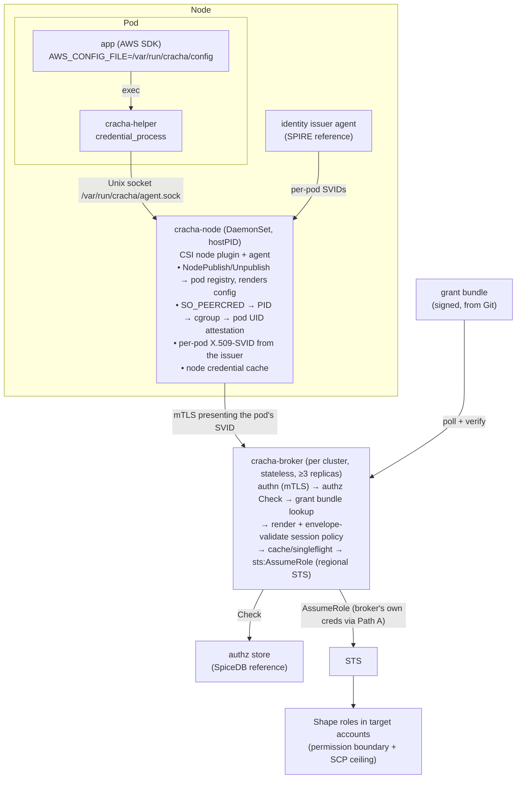

# Crachá: Workload AWS Credentials via SPIFFE Identity, a Credential Broker, a Pluggable Authorization Store and a Node Agent

Project: Crachá (`cracha`, https://cracha.dev) · Status: Draft · Owner: Bruno (platform) · Last updated: 2026-10-16

Naming: binaries and Kubernetes objects use the ASCII form `cracha-*`. The CSI driver, annotations and any API groups live under `cracha.dev` (e.g. `csi.cracha.dev`, `cracha.dev/enabled`).

## 1. Problem

IAM role quotas (1,000 roles per account by default, max 5,000) make "one IAM role per workload" unsustainable. Workloads still need different permissions. We need many logical permission sets backed by few IAM roles, with per-workload attribution and fast revocation, across any Kubernetes cluster, managed or self-hosted.

## 2. Goals / non-goals

Goals
- A few IAM roles per account, one per **permission shape** (e.g. `shape-s3-reader`, `shape-dynamo-rw`).
- Workload identity = **SPIFFE ID**, obtained through the standard SPIFFE Workload API from a pluggable issuer. SPIRE is the reference issuer, not a dependency of the design. Uniform across all clusters regardless of platform or cloud provider.
- Per-workload scope enforced via ABAC session tags and, where needed, **session policies** issued by a central broker.
- **Who may get what** lives in a **pluggable authorization store** behind a small, backend-neutral interface. SpiceDB is the reference backend, not a dependency of the design. **What a credential may look like** lives in a signed, Git-managed bundle.
- No application/SDK code changes. No bearer secrets on disk or on the network in the default mode.
- CloudTrail attributes every call on a shared role to the real workload (`SourceIdentity`).
- Targeted revocation of live sessions for a single workload.

Non-goals
- Human access.
- Coupling the broker or node agent to one authorization engine or one identity issuer. Backend-specific types never leave their adapter package.
- Long-lived credentials.
- Replacing ABAC-only access (Path A) for the majority of workloads.

## 3. Architecture overview

Two credential paths share one identity system:

| Path | Use when | Mechanism |
|---|---|---|
| **A (default)** | Same actions, different resources | JWT-SVID → `sts:AssumeRoleWithWebIdentity` on a shape role; ABAC via session tags in the JWT |
| **C (broker)** | Permissions must be centrally narrowed and enforced | Node agent → mTLS (pod's X.509-SVID) → broker → authz check → `sts:AssumeRole` with session policy + tags |

(Path B, IAM Roles Anywhere with X.509-SVIDs, is reserved for non-AWS-hosted workloads and is out of scope for the first implementation.)



## 4. Identity

The design depends on the **SPIFFE standard**, not on a particular issuer. Any issuer that meets the contract in 4.1 can be used; SPIRE is the reference implementation (4.2).

- **SPIFFE ID scheme:** `spiffe://<trust-domain>/ns/<namespace>/sa/<serviceaccount>`. The scheme is enforced by the issuer's registration policy, whatever the issuer.
- The cluster is **not** part of the identity. The same workload running in several clusters of a trust domain has one SPIFFE ID, so active-active deployments share grants by default. Cluster is context: in Path C the broker knows which cluster it serves and attaches it; in Path A it is available only when the issuer can add claims. Per-cluster scoping is expressed as an assignment condition (6.4), never as a separate identity.
- The issuer is a Tier-0 service: signing keys in KMS/HSM, per-region deployment or a nested hierarchy under a shared root.
- Crachá is trust-domain-agnostic. Trust domain topology (one domain with a nested hierarchy, or several federated domains) is the issuer operator's choice. It touches Crachá in two places only: Path A needs one IAM OIDC provider per trust domain, and a workload's identity is scoped to its trust domain, so per-region domains give the same workload a different identity per region.
- The service mesh (Istio, multi-primary) should eventually consume the same issuer via Envoy SDS, so mesh identity == AWS identity. Not required for v1.

### 4.1 Identity issuer contract

What Crachá needs from the issuer, and the standard mechanism for each:

| Need | Used by | Standard mechanism | Adapter responsibility |
|---|---|---|---|
| Own X.509-SVID and trust bundle (incl. federated bundles) | broker, cracha-node | SPIFFE Workload API (`go-spiffe/v2`) | none, standard |
| JWT-SVID with `aud=sts.amazonaws.com` | Path A workloads, broker's own creds | SPIFFE Workload API | none, standard |
| OIDC discovery (JWKS) for the trust domain | IAM OIDC provider (Path A) | SPIFFE OIDC federation, public HTTPS endpoint | issuer-specific deployment |
| ABAC claims in JWT-SVIDs (`https://aws.amazon.com/tags`) | Path A | no standard | issuer hook where available; otherwise ABAC tags are derived by IAM from `sub` path segments (`StringLike` conditions) |
| **Per-pod X.509-SVID obtained by cracha-node on the pod's behalf** | cracha-node (Path C) | no standard | issuer adapter: subscribe to a pod's SVID stream keyed by pod UID; subscription dropped on unpublish |
| Node and workload attestation | all | issuer-specific | platform-specific attestor per cluster type (e.g. instance identity for cloud nodes, projected SA tokens for self-hosted clusters) |

Rules:
- The broker and Path A touch only the Workload API and are issuer-agnostic by construction.
- The per-pod delivery hook is the one issuer-specific piece. It sits behind an adapter so cracha-node has no issuer-specific code.
- Any issuer must guarantee: SVID rotation delivered before expiry, subscription for an unregistered pod UID rejected, subscription torn down on unpublish, trust bundle refresh.
- SPIRE is the reference issuer. Other SPIFFE-conformant issuers (e.g. cert-manager with csi-driver-spiffe, a mesh CA exposing the Workload API) need only the per-pod delivery adapter.

### 4.2 Reference issuer: SPIRE

- SPIRE server per region (or nested SPIRE under a shared upstream root). Keys via KMS/HSM UpstreamAuthority.
- Node attestation: `aws_iid` for EC2-backed nodes, `k8s_psat` for self-hosted clusters.
- Workload attestation: k8s workload attestor. Entries managed by SPIRE Controller Manager `ClusterSPIFFEID`.
- OIDC discovery: SPIRE OIDC Discovery Provider.
- ABAC claims: a **CredentialComposer** plugin adds `principal_tags` (ns, sa, cluster; plus service/team once the authz store is live).
- Per-pod SVID delivery: the **Delegated Identity API** on the agent's admin socket, selector `k8s:pod-uid:<uid>`, with `authorized_delegates` restricted to cracha-node's SPIFFE ID.

### 4.3 Identity encodings

Several systems restrict characters, so one deterministic encoding, owned by a single shared library, is used everywhere:

| Target | Constraint | Encoding |
|---|---|---|
| STS `SourceIdentity`, `RoleSessionName` | `[\w+=,.@-]`, 2–64 chars | `w.<td-short>.<ns>.<sa>`; if >64 chars → `w.h.<sha256 base32 prefix>` |
| Authz subject ID (SpiceDB object ID charset, the strictest backend considered) | `[a-zA-Z0-9/_\|\-=+]`, ≤1024 | `<td-short>/<ns>/<sa>` (no `.`/`:`; escape rule defined by the library) |
| Session tags | standard tag charset | raw `ns`, `sa`, `cluster` values |

The mapping (encoded → full SPIFFE ID) is logged at every issuance to keep audit reversible.

## 5. Path A: JWT-SVID direct federation (default)

- The issuer's OIDC discovery endpoint at a public HTTPS URL; registered as an IAM OIDC provider per trust domain.
- JWT-SVID with `aud=sts.amazonaws.com`, TTL ≤ 5 min, fetched through the Workload API.
- ABAC tags come from the `https://aws.amazon.com/tags` claim (`principal_tags`: ns, sa, cluster; plus service/team once the authz store is live) when the issuer can add it (SPIRE: CredentialComposer). Without that hook, policies fall back to `StringLike` conditions on the `sub` path segments, which covers ns/sa but not cluster, service or team.
- One role per shape; trust policy `StringLike` on `<provider>:sub` (scoped pattern) and allows `sts:TagSession`.
- Policies scope resources with `${aws:PrincipalTag/...}` and `aws:ResourceTag/...`.
- The broker's own credentials use Path A.

## 6. Path C: credential broker

### 6.1 Responsibilities split

- **Grant bundle (Git, signed):** shapes, base roles, policy templates, allowed ARN envelopes, profiles. Answers *what*.
- **Authorization store (pluggable, SpiceDB reference):** assignments of grants to services/workloads, service membership, ownership, temporary access. Answers *who*.

### 6.2 Grant definition (bundle)

```yaml
kind: Grant
metadata:
  name: payments-ledger-rw
spec:
  account: "111122223333"
  baseRole: arn:aws:iam::111122223333:role/broker/shape-dynamo-rw
  profile: default                 # named profiles for workloads needing >1 shape
  sessionPolicy:
    template: dynamo-table-rw
    params: { tables: [ledger, ledger-outbox] }   # or resolved via the authz store (Level 3)
  managedPolicyArns: []            # escape hatch for large policies (max 10)
  sessionTags: { team: payments }
  duration: 3600                   # optional; default 1h, capped at 1h by role chaining
  envelope:                        # runtime ARN allowlist for rendered policies
    - arn:aws:dynamodb:*:111122223333:table/payments-*
```

CI (`grant-compiler`) pipeline:
1. Render templates.
2. Access Analyzer `ValidatePolicy`.
3. `CheckNoNewAccess` against the shape's envelope policy.
4. Size budget lint (2,048-char inline session policy + packed tag budget).
5. Uniqueness: at most one grant per (profile, account) per assignee.
6. Compile → sign (KMS or cosign) → publish to S3.

Broker polls the bundle, verifies signature, swaps atomically, and **keeps the last good bundle on failure (never fails open).**

### 6.3 Authorization store contract

The broker depends only on this contract. Each backend is an adapter chosen by configuration, and all adapters must give the same answers to the same questions.

| Question | Operation | Answer | Required |
|---|---|---|---|
| May this workload assume this grant? | Check(subject, grant, consistency) | allow/deny, the matching grant (ambiguity is a deny, see 6.5), ABAC tags such as service and team, a consistency token, a decision trace | yes |
| Which grants (profiles) may this workload assume? | ListGrants(subject, consistency) | grant list + consistency token | yes |
| Which resources of a kind may this workload use? | LookupResources(subject, kind, permission) | resource list, for Level 3 template filling | optional |
| What changed since this token? | Watch(since) | stream of assignment changes, for cache invalidation | optional; without it the cache degrades to TTL-only invalidation |

Rules:
- Subject = the workload's authz encoding (4.3) plus the cluster the broker serves. The subject never carries anything the workload can set itself.
- Consistency tokens are opaque outside the adapter. SpiceDB's zedToken is one implementation; a static backend may use a file hash. Callers may ask for minimize-latency or at-least-as-fresh(token).
- Any failure to answer is a deny. Backends never fail open.
- Time-bounded and cluster-bounded assignments are part of the model, not of one backend's caveat feature. A backend without native conditions evaluates them in its adapter.
- Backends: `static` (signed assignment file, for bootstrap, air-gapped or tiny installs) and `spicedb` (reference). OpenFGA or a Cedar-based store would be further adapters, not design changes.

### 6.4 Reference backend: SpiceDB

The model below is the reference. Another backend must express the same concepts (team, service, workload, grant, account, time-bounded and cluster-bounded assignment) and give equivalent answers to the questions in 6.3.

```zed
definition team {}

definition service {
  relation owner: team
  relation member: workload
}

definition workload {}            // id = idenc authz encoding

definition aws_account {}

caveat within_window(expires_at timestamp, now timestamp) {
  now < expires_at
}

caveat in_clusters(allowed list<string>, cluster string) {
  cluster in allowed
}

definition grant {
  relation account: aws_account
  relation assignee_service: service | service with in_clusters
  relation assignee_workload: workload with within_window
  permission assume = assignee_service->member + assignee_workload
}

definition dynamodb_table {       // Level 3 only
  relation account: aws_account
  relation writer: service
  relation reader: service
  permission write = writer->member
  permission read  = write + reader->member
}
```

Integration levels:
- **L1 (v1):** `Store.Check(subject, grant)` gates issuance (SpiceDB: `CheckPermission(grant#assume, workload)`).
- **L2 (v1):** service/team returned in `Decision.Tags` become session tags for ABAC.
- **L3 (later, exceptions only):** `Store.LookupResources` fills template resource lists; every ARN is validated against the grant envelope at runtime; violations reject the request.

Relationship writers (write access to the authz store is security-critical, whatever the backend). Where a writer reads its source of truth from is out of scope; what Crachá requires is that the writer is trusted and that no relationship is derived from anything the workload controls:

| Relationship | Source of truth | Writer |
|---|---|---|
| `service#owner`, `grant#assignee_service` | Git (CODEOWNERS) | `authz-reconciler` |
| `service#member@workload` | Service catalog / Git. **Never** workload-controlled annotations | `authz-reconciler` |
| Temporary / break-glass | Approval flow | `access-approver`, with caveat/expiry |

Deployment (SpiceDB): one instance per region on its own Postgres. The reconciler writes to every region through the backend adapter (regions stay independent).

### 6.5 Broker API

```
POST /v1/credentials          (mTLS; client SPIFFE ID from URI SAN)
{ "account": "111122223333", "profile": "default" }

200 { "AccessKeyId", "SecretAccessKey", "SessionToken", "Expiration",
      "grant": "payments-ledger-rw", "bundleVersion": "...", "consistencyToken": "..." }
403 { "reason": "no_grant" | "ambiguous" | "subject_suspended" | "envelope_violation" }

GET /v1/profiles              (mTLS) → profiles the caller can assume (`Store.ListGrants`)
```

The broker terminates mTLS itself with go-spiffe (trust bundle + federated bundles from its own Workload API). Exclude its port from Istio interception. Never trust proxy-asserted identity headers.

### 6.6 STS mechanics

- Broker's role (`cracha-broker`, per environment) → `AssumeRole` on shape roles. This is role chaining, so the session max is 1 hour. Session duration is configurable per grant and defaults to 1 hour; targeted revocation (6.8) covers the window.
- Each call sets:
  - `SourceIdentity` = `RoleSessionName` = idenc STS encoding (per workload, not per pod)
  - `Policy` / `PolicyArns` = rendered session policy
  - session tags: `spiffe-ns`, `spiffe-sa`, `cluster`, `grant`, `team`, `service` (non-transitive)
- Shape role trust policy:

```json
{
  "Effect": "Allow",
  "Principal": { "AWS": "arn:aws:iam::PLATFORM:role/cracha-broker-prod" },
  "Action": ["sts:AssumeRole", "sts:SetSourceIdentity", "sts:TagSession"],
  "Condition": {
    "StringLike": { "sts:SourceIdentity": "w.*" },
    "ForAllValues:StringEquals": {
      "aws:TagKeys": ["spiffe-ns", "spiffe-sa", "cluster", "grant", "team", "service"]
    }
  }
}
```

- Shape role ceiling: permission boundary with explicit denies on `iam:*`, `sts:AssumeRole*`, `organizations:*`, key administration; backed by SCPs.
- Separate `cracha-broker` roles per environment/account tier. A dev broker can't assume prod shapes.

### 6.7 Caching

- Broker cache key: `(account, grant, bundleVersion, encoded workload)`. In-memory only, singleflight on miss, refresh-ahead at ~70% TTL, never return creds with <20 min left.
- **Re-check the authz store on every issuance, including cache hits** (cheap at refresh frequency).
- `Store.Watch` invalidates affected cache entries on assignment changes. Backends without Watch degrade to TTL-only invalidation, and the broker exposes which mode is active.
- Consistency: minimize latency by default; at-least-as-fresh when a caller (approver/revocation tool) supplies a consistency token.
- Authz store unavailable: fail closed for new keys; serve cache hits only if the last successful check for that key is <10 min old.

### 6.8 Revocation

1. Stop issuance: remove the relationship (or suspend the grant in the bundle) and flush the cache via Watch.
2. Kill live sessions: `revoke-tool` attaches an inline deny to the shape role, scoped to one workload, and removes it after 1h:

```json
{ "Effect": "Deny", "Action": "*", "Resource": "*",
  "Condition": {
    "StringEquals": { "aws:SourceIdentity": "w.prod.payments.ledger" },
    "DateLessThan": { "aws:TokenIssueTime": "2026-10-16T14:00:00Z" } } }
```

Optionally triggered automatically when Watch observes an assignment deletion.

## 7. Delivery: cracha-node (CSI + node agent)

### 7.1 CSIDriver

```yaml
apiVersion: storage.k8s.io/v1
kind: CSIDriver
metadata:
  name: csi.cracha.dev
spec:
  attachRequired: false
  podInfoOnMount: true
  volumeLifecycleModes: [Ephemeral]
  requiresRepublish: true
  tokenRequests:
    - audience: cracha-node
      expirationSeconds: 600
```

### 7.2 Volume contents (read-only to the container, plugin-owned)

```
/var/run/cracha/
├── config              rendered per pod
├── bin/cracha-helper   static binary (CGO_ENABLED=0), matched to node arch
└── agent.sock          Unix socket served by cracha-node
```

Rendered config:

```ini
[default]
credential_process = /var/run/cracha/bin/cracha-helper --profile default
region = <from node topology.kubernetes.io/region>
sts_regional_endpoints = regional

[profile archive]
credential_process = /var/run/cracha/bin/cracha-helper --profile archive --account 444455556666
region = <...>
```

### 7.3 NodePublishVolume

1. Read pod UID, namespace, SA from the volume context (kubelet-supplied).
2. Verify the kubelet-provided bound SA token. Its pod-binding claims must match the volume-context pod UID.
3. Register the pod. Subscribe to its X.509-SVID through the issuer adapter (SPIRE: Delegated Identity API, `k8s:pod-uid:<uid>`).
4. Fetch profiles from the broker (`GET /v1/profiles`) and render `config` atomically (write temp + rename).
5. Prefetch default credentials into the node cache.

Kubelet doesn't start containers until publish succeeds, so credentials are ready before app start.

`requiresRepublish`: re-validate the pod, re-render config when profiles change. Note: SDKs usually parse the config only when a client is created, so new profiles appear on new clients/restarts. Removal is effective immediately via the broker.

`NodeUnpublishVolume`: drop the registry entry, the SVID subscription and the cache refs.

### 7.4 Request path and attestation

- `cracha-helper` connects to `agent.sock`, requests `{profile, account}`, and prints credential_process JSON: `{"Version":1,"AccessKeyId","SecretAccessKey","SessionToken","Expiration"}`. `Expiration` is mandatory, so SDKs refresh.
- cracha-node attests via `SO_PEERCRED` → PID → `/proc/<pid>/cgroup` → pod UID (requires `hostPID: true`). Re-validate after lookup to avoid PID-reuse races. Must match a registered pod.
- Node cache keyed by `(workload identity, account, profile)`, shared by pods of the same workload on the node. Refresh at 50% TTL.
- To the broker: one mTLS connection pool per workload identity, presenting that pod's SVID.

### 7.5 Webhook (`cracha-webhook`)

For ServiceAccounts annotated `cracha.dev/enabled: "true"`, inject:
- the CSI inline volume
- `AWS_CONFIG_FILE=/var/run/cracha/config`, `AWS_SDK_LOAD_CONFIG=1`

It strips or rejects `AWS_ACCESS_KEY_ID`, `AWS_SECRET_ACCESS_KEY`, `AWS_WEB_IDENTITY_TOKEN_FILE` and `AWS_CONTAINER_CREDENTIALS_*`. Pods with their own `AWS_CONFIG_FILE` use merge mode (managed profiles + ConfigMap-provided profiles). IMDS is blocked for pods (hop limit 1 / CNI policy).

### 7.6 Fallback mode: link-local endpoint (opt-in)

For workloads that can't use credential_process:
- cracha-node serves the container-credentials protocol on `169.254.170.2` (dummy interface; Talos via machine config, EKS needs `NET_ADMIN`). `.23` stays reserved for the EKS Pod Identity agent.
- The CSI volume additionally contains a per-pod random token. Inject `AWS_CONTAINER_CREDENTIALS_FULL_URI` and `AWS_CONTAINER_AUTHORIZATION_TOKEN_FILE`.
- Validate token + **source IP == registered pod IP**. hostNetwork callers are denied.
- Precondition: the CNI must deliver pod traffic to the node's link-local address unmasqueraded, so the source IP is the pod's real IP. Where the CNI masquerades or does not route link-local traffic to the host, the IP check is unsound and fallback mode must stay disabled.

### 7.7 cracha-node hardening

- Distroless, read-only rootfs, dedicated namespace. `hostPID` required. No `NET_ADMIN` unless fallback mode is enabled on EKS.
- Issuer agent: the per-pod delivery hook is restricted to cracha-node's identity (SPIRE: admin socket with `authorized_delegates` = cracha-node's SPIFFE ID only). Registration entry restricted to the cracha-node SA/namespace.
- Alert on per-pod SVID subscriptions for pod UIDs absent from the node's kubelet view.

## 8. Failure modes

| Failure | Behavior |
|---|---|
| Broker down | SDK-cached + node-cached creds keep running pods alive ~30 min+. New pods block at volume publish. |
| STS throttle/outage | Broker serves cache, retries with jitter, alerts on cache age. |
| Authz store down | Fail closed for new keys; bounded-staleness cache hits (<10 min since last check). |
| Identity issuer agent down | Existing SVIDs work until TTL; new pods block at publish. |
| cracha-node restart | Registry rebuilt from kubelet pods + existing CSI mounts; brief errors, SDK retries. |
| Bad/unsigned bundle | Keep last good bundle, alert. Never fail open. |

## 9. Threat model (summary)

| Compromise | Impact | Mitigation |
|---|---|---|
| App container | Its own grants | Read-only volume, no secrets on disk (default mode) |
| Node | Pods on that node | Per-node parenting of workload entries, node attestation, short SVID TTL |
| cracha-node | Pods on that node (≈ node) | Hardening §7.7, delegate alerts |
| Broker | Grants in its environment, capped by shape ceilings | Dedicated nodes, per-env roles, alert on shape-role assumption without `SourceIdentity` / by other principals |
| Grant repo | Misuse within shape envelopes | CODEOWNERS, `CheckNoNewAccess`, signed bundles |
| Authz store writes | Misassignment within shapes | Restricted writers, change-feed audit log, envelope check |
| Identity issuer (e.g. SPIRE server) | Mint any identity | Tier-0 controls, KMS/HSM keys |

## 10. Open questions

- Q1 (resolved 2026-10-16): the cluster is not in the SPIFFE ID path. Identity is cluster-agnostic; per-cluster scoping is an assignment condition.
- Q2 (resolved 2026-10-16): trust domain topology is out of scope; the design is trust-domain-agnostic (see 4).
- Q3 (resolved 2026-10-16): the source of truth behind `service#member@workload` is out of scope. Crachá requires a trusted writer, not a particular catalog.
- Q4 (resolved 2026-10-16): session duration is configurable per grant, default 1h.
- Q5: Approval flow for temporary access: build vs reuse existing tooling.
- Q6: Minimum SDK versions across the fleet that support `credential_process` in the default chain.
- Q8: Second production-grade authz backend to prove the store contract (OpenFGA vs. a Cedar-based store), and when.
- Q9: Second identity issuer to prove the issuer contract (cert-manager csi-driver-spiffe is the likely candidate), and whether per-pod delivery without a delegated API is acceptable there.

## 11. Invariants

These hold regardless of backend, issuer or platform. Any implementation must be able to demonstrate each one.

- Never fail open: an unavailable authz store, issuer or bundle results in denial, or in serving already-issued credentials within bounded staleness, never in broader access.
- Every rendered session policy is checked against the grant's envelope before STS is called.
- `SourceIdentity` is set on every assumed session and is reversible to a SPIFFE ID through the decision log.
- cracha-node writes no credentials to disk in default mode.
- The cache never returns credentials with less than 20 minutes remaining.
- All identity encodings come from the single shared encoding library. Nothing hand-formats a SourceIdentity or an authz subject ID.
- Backend-specific and issuer-specific types never leave their adapter.
- Diagrams in this document are Mermaid.
